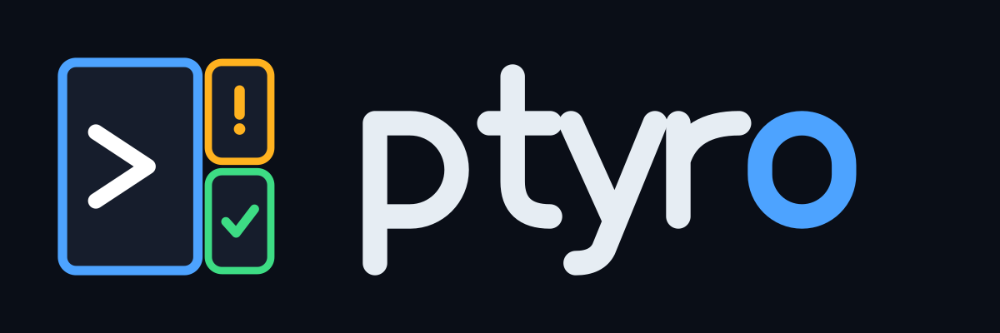

<p align="center">
  <picture>
    <source media="(prefers-color-scheme: light)" srcset="docs/logos/ptyro-logo-on-white.png">
    
  </picture>
</p>

# ptyro

**A terminal-native home for your coding agents.**

ptyro runs Claude Code, Codex, Gemini CLI and OpenCode side by side, each in its own git
worktree, inside the terminal you already use. A background daemon owns every session, so you
can detach, close the terminal or lose SSH, and the agents keep working. ptyro knows which agent
is working, which is blocked on a permission prompt and which is done, and one key takes you to
the one that needs you. When a task is too big for one agent, it can fan the work out, run
recipes, or coordinate one change across several repositories.

## What you get

- **Sessions that survive.** Detach and reattach to the exact screen; a crash or reboot brings
  agents back, ready to resume the same conversation.
- **One worktree per task.** A new branch and checkout, `.env` copied, setup script run, ports
  allocated, agent started. Removing a worktree refuses to lose unpushed work.
- **Real agent status.** Working, blocked, idle or done, from the agents' own hooks, not screen
  scraping. An inbox and notifications tell you who needs you.
- **Work and personal, never crossed.** Profiles keep accounts, git author, SSH keys and secrets
  apart, per repository.
- **Review and ship without leaving.** Diff, line comments for the agent, commit, PR, CI fixes.
- **Many agents at once.** Fan one task out to several agents and pick the best, run recipe
  workflows, or let a lead agent manage workers.
- **Your phone.** A web app shows every agent and answers its permission prompts.
- **Scriptable.** Every action is a command, most with `--json`.

## Status

Pre-1.0 (version 0.0.x), public for early testing. Every
feature milestone (M1–M11) is built and covered by tests, most of them against scripted fake
agents. Day-to-day use so far is mainly Claude Code on Linux. Some features have not been run
against the real thing yet: the phone app on a real phone, OpenCode, Gemini and Codex structured
turns, a real merge train, and macOS by hand. [`docs/compat.md`](docs/compat.md) records what has
been tried, and [`ROADMAP.md`](ROADMAP.md) what's next. Bug reports are very welcome.

ptyro is an independent project. It is not affiliated with or endorsed by Anthropic, OpenAI,
Google, or any other tool named here; their names and trademarks belong to their owners.

## Requirements

- **Linux, macOS or WSL2.** On WSL2 nothing needs setting up: WSL normally stops a distro
  about 15 seconds after its last terminal closes, so ptyro's daemon keeps WSL running while it
  runs, and your agents keep working with every terminal closed. `ptyro daemon stop` lets WSL
  stop; `[daemon] hold_wsl = false` (Settings → daemon) turns that off. **On Windows itself**,
  `ptyro.exe` is a client of the daemon in WSL ([below](#windows)); a native Windows daemon is
  planned (ROADMAP WIN, track D).
- **Rust 1.99 or later** to build. A checkout pins 1.99.1 in `rust-toolchain.toml`, and
  [rustup](https://rustup.rs) fetches it for you. No Rust yet? In a checkout, `make rust-install`
  installs rustup and the pinned toolchain on Linux, macOS and Windows. It needs a C compiler,
  which it checks for but never installs. On Windows that means the Visual Studio Build Tools'
  C++ workload, and the target runs from Git Bash, MSYS2 or Cygwin (without make, run
  `sh scripts/rust-install.sh`).
- **git 2.40 or later**, and **GNU make** for building from a checkout.
- **At least one agent CLI:** [Claude Code](https://code.claude.com) (the best supported),
  [Codex CLI](https://github.com/openai/codex), [Gemini CLI](https://github.com/google-gemini/gemini-cli)
  or [OpenCode](https://opencode.ai). Any other program runs too, with less status detail.
- **A modern terminal:** Ghostty, kitty, WezTerm, Alacritty, iTerm2, foot… Inside tmux works too.
- **Optional:** the [GitHub CLI](https://cli.github.com) (`gh`) for PRs and checks;
  [Tailscale](https://tailscale.com) for the phone app.

## Install

```bash
git clone https://github.com/nealhardesty/ptyro.git && cd ptyro
make install            # builds and installs ~/.cargo/bin/ptyro
```

Or, without a checkout, the latest prebuilt release (Linux and macOS, x86_64 and aarch64):

```bash
curl -fsSL https://github.com/nealhardesty/ptyro/releases/latest/download/install.sh | sh
```

It downloads the tarball for your machine, checks it against the release's `SHA256SUMS` (and its
signed build provenance when you have `gh`), and installs `~/.local/bin/ptyro` (`PTYRO_VERSION`,
`PTYRO_PREFIX` choose another). Every release carries the script, so this URL is always the newest
one. Options go after `sh -s --`:

```bash
curl -fsSL https://github.com/nealhardesty/ptyro/releases/latest/download/install.sh | sh -s -- --uninstall --dry-run
curl -fsSL https://github.com/nealhardesty/ptyro/releases/latest/download/install.sh | sh -s -- --uninstall
curl -fsSL https://github.com/nealhardesty/ptyro/releases/latest/download/install.sh | sh -s -- --help
```

`--uninstall` hands over to `ptyro uninstall` (see [Removing ptyro](#removing-ptyro) below), and
anything after it goes along too (`--dry-run`, `--yes`, `--backup FILE`). If the installed binary
won't run, the script removes just what it installed. Or build it yourself:

```bash
cargo install --locked --git https://github.com/nealhardesty/ptyro ptyro
```

Make sure `~/.local/bin` (or `~/.cargo/bin`) is on your `PATH`.

With Homebrew (macOS and Linux):

```bash
brew install nealhardesty/ptyro/ptyro
brew upgrade ptyro      # then `ptyro daemon upgrade` to move running sessions onto it
brew uninstall ptyro    # `ptyro uninstall` removes your data first and names this command
```

Each release updates the tap automatically.

**Downloading a tarball by hand** from the [releases page](https://github.com/nealhardesty/ptyro/releases/latest)?
Check it: `shasum -a 256 -c SHA256SUMS --ignore-missing`, and who built it:
`gh attestation verify ptyro-<version>-<target>.tar.gz --repo nealhardesty/ptyro`. Each release
also has its software bill of materials (`ptyro-<version>.cdx.json`, CycloneDX). The macOS
binaries aren't notarized, and a browser marks its downloads as quarantined, so Gatekeeper
refuses them: run `xattr -d com.apple.quarantine ptyro` once, or use the install script (curl
doesn't set the mark). Then let ptyro look around:

```bash
ptyro init       # finds your agents, accounts and repositories; asks a few questions
ptyro doctor     # checks agents, logins, integrations, terminal and tmux
```

**Upgrading** while agents run: install the new binary (run the install script again), then
`ptyro daemon upgrade`. Every session keeps running.

### Removing ptyro

`ptyro uninstall` (or the install script's `--uninstall`, or `-Uninstall` on Windows) shows what it keeps on your machine (sessions, worktrees
with any uncommitted work flagged, its directories, the login service, integrations, shell-rc
lines, the binary), asks, and removes it; `ptyro backup` saves its state first. Your repositories,
their branches and `.ptyro.toml` stay. See [`docs/uninstall.md`](docs/uninstall.md).

### Windows

ptyro's daemon (where your agents run) lives in WSL2. From Windows itself, `ptyro.exe` is its
client: the TUI in Windows Terminal, and every command from PowerShell.

1. Install ptyro in your WSL distro, as above (`wsl` opens it).
2. Install `ptyro.exe`, from PowerShell (x64 and ARM64):

   ```powershell
   irm https://github.com/nealhardesty/ptyro/releases/latest/download/install.ps1 | iex
   ```

   It downloads the release's zip for your machine, checks it against `SHA256SUMS` (and its
   signed build provenance when you have `gh`), installs `%LOCALAPPDATA%\Programs\ptyro\bin\ptyro.exe`
   and puts that folder on your `PATH` (`$env:PTYRO_VERSION`, `PTYRO_PREFIX`,
   `PTYRO_NO_MODIFY_PATH=1` change that). `ptyro uninstall` removes it again, `PATH` entry
   included. So does the script: `iex` takes no arguments, so set `PTYRO_UNINSTALL` or run it as
   a script block, whose arguments go to `ptyro uninstall`:

   ```powershell
   $env:PTYRO_UNINSTALL = '1'; irm https://github.com/nealhardesty/ptyro/releases/latest/download/install.ps1 | iex
   & ([scriptblock]::Create((irm https://github.com/nealhardesty/ptyro/releases/latest/download/install.ps1))) -Uninstall --dry-run
   ```
 `ptyro.exe` isn't code-signed yet, so Windows' Smart App Control, when it's on, may
   refuse to run it; the installer says so if it does. Or build it yourself: see
   [Build on Windows](#build-on-windows); from Linux or WSL, `make check-windows`'s toolchain
   cross-builds it (`cargo xwin build --release --target x86_64-pc-windows-msvc -p ptyro`,
   `aarch64-…` for ARM).
3. Run `ptyro`. The first time, it finds the WSL distro that has ptyro and asks to use it (or
   offers to install it there); the answer is kept in `client.default_remote`
   (`ptyro --remote wsl://<distro>` picks one for a single command).

What works from Windows: the TUI (the WSL daemon's sidebar, attaching, typing), every CLI command
(`ptyro ls --json | ConvertFrom-Json` in PowerShell), and opening a session in a new Windows
Terminal tab or pane (`ptyro attach S --tab`, `--pane`; the TUI's `session.tab`). The folder you
run `ptyro new` in becomes the distro's (`C:\src` is `/mnt/c/src`). "Open in" an editor or the
file manager opens it from WSL, on this computer (VS Code through Remote-WSL, the folder in
Explorer). Sessions get Windows Terminal's own colours, and Shift+Enter works without any setup.
Settings: the screen's own (the look, keys, themes, the clipboard) are `ptyro.exe`'s; everything
else is read by the daemon in WSL, so the settings panel marks those "daemon's" and opens the
daemon's file to change them (`ptyro config set` of one says where it lives). Commands a daemon
host runs (`tour`) say to run them inside WSL.

**Start at login.** `ptyro daemon install-service` (the TUI's palette, `daemon.service`; the web
app's More → Daemon → Install the service) adds a logon task to Windows' Task Scheduler that
starts WSL and its ptyro daemon when you log on, so your agents and the web app are there before
you open a terminal. It runs as you, needs no administrator, and opens no window
(`ptyrow.exe`, installed beside `ptyro.exe`, starts it hidden). `ptyro daemon uninstall-service`
removes it.

**Notifications.** The daemon's desktop notifications are Windows toasts from "ptyro", with its
icon. Clicking one opens that session in a new Windows Terminal tab; a permission prompt's toast
has Approve and Deny buttons when [approve links](#agent-status-and-notifications) are on. `ptyro.exe` registers
itself with Windows the first time it runs (in your user's registry, no administrator), and
`ptyro uninstall` takes that away again.

**A daemon on Windows itself (preview).** ptyro can also run its daemon natively, with sessions
in Windows' pseudoconsoles (ConPTY) and your repos on NTFS. It is still being built (shells,
processes and agents on Windows come next), so WSL stays the default. To try it:

```powershell
ptyro config set client.default_remote local   # or once: ptyro --remote local …
ptyro new                                      # starts the daemon, then a shell (PowerShell)
```

`local` means this computer's own daemon; `ptyro config unset client.default_remote` goes back
to WSL. The zip ships Microsoft's packaged ConPTY (`conpty.dll`, `OpenConsole.exe`) beside
`ptyro.exe`: it passes programs' output through untouched, where Windows' own repaints it, so
`ptyro doctor` warns when those two files are missing. A project's scripts run in the shell
they're written for: a `.ps1` file in PowerShell, a `.sh` file (and Conductor's and the other
tools' imported scripts) in Git Bash, the rest in PowerShell; `[scripts] shell` in
`.ptyro.toml` (or the settings panel) picks one for the whole project. A bash script checked out
with Windows line endings is a `doctor` finding, and `ptyro project line-endings` fixes it. The daemon listens on a named pipe only
you can open. `ptyro daemon install-service` then starts this native daemon at logon instead of
WSL's, and `ptyro serve` (the web app, with its own certificate, pairing and Tailscale's) runs
here too. Not there yet: a live `daemon upgrade` (stop and start it; agents' conversations
can be resumed) and the foreground program's name and directory.

**Reaching a Windows computer from elsewhere.** `ptyro --remote me@winbox` works over Windows'
own OpenSSH server (Settings → System → Optional features → OpenSSH Server): ptyro notices the
host is Windows and runs `ptyro proxy` there as it is, reaching whichever daemon that computer
uses, WSL's included. `ptyro machine add` links it into [another machine's view](#your-phone-and-other-machines)
either over ssh or with a code from its `ptyro machine pair`.

## Quick start

**1. Open ptyro in a repository.**

```bash
cd ~/dev/myrepo
ptyro                   # open the TUI (a shell session to start with)
```

The very first time, with no config yet, ptyro shows what it found (your agents, the accounts in
your shell setup, your repositories) as a list to tick, and writes the config from that. Outside a
repository, it opens **home**: who needs you, PRs, recent projects and repositories found, each a
`⏎` away from a task (`Ctrl-Q H` brings it back).

The repository you're in becomes a **project** by itself, so it shows in the sidebar ready for
worktrees. The status bar says so, and `Ctrl-Q u` undoes it (it then stays out until you add
it). `Ctrl-Q P` adds another repository; `[discover] auto_register = false` turns this off.

Every key starts with the **prefix**, `Ctrl-Q` (or `Ctrl-Space`). Pause after it and a menu of
the next keys appears; `Ctrl-Q ?` lists them all, and `ptyro tour` lets you try the whole loop
(a task, its permission prompt, the review, finishing and cleaning up) with a pretend agent in a
throwaway repository, deleted afterwards. The
status bar says what you'd do next with what's selected (`C-q p answer it`).

**2. Detach and come back.** Press `Ctrl-Q d`. Everything keeps running in the daemon. Run
`ptyro` again and you're back on the same screen. To stop ptyro altogether, press `Ctrl-Q
Ctrl-D`: it lists what will stop and asks first. Agents that can resume hibernate and come back
dormant next time; shells and other programs end. From a shell, `ptyro daemon stop --force`
does the same.

**3. An agent on a task, in its own worktree.** Press `Ctrl-Q n`, type what it should do, and
press `⏎`: Claude starts on it in a fresh worktree, on its own branch, named after the task
(`fix-flaky-test`; the box shows the name before you press `⏎`, and Tab changes it). Or from
the shell:

```bash
ptyro "fix the flaky test in tests/api.rs"     # the same, then attach
ptyro new -d --agent claude --new-wt --prompt "fix the flaky test in tests/api.rs"   # detached
```

Every session and worktree has a **name** (its address: `ptyro send fix-flaky-test …`) and a
**title** (what people read, the task by default). `ptyro retitle` and `ptyro wt retitle` change
the title, `ptyro rename` the name.

**4. See who needs you.** The sidebar shows each session's status. `⚑` means it wants you.

```text
 WORKSPACE main [work]        │ ● claude · claude · [work] · ptyro/brisk-rook +42 −7 · :20001
 ▾ myrepo [work]              │ (Claude, full fidelity, in its own worktree)
   ▾ @root (main)             │
     1 • shell zsh            │
         last cargo test ✓ 41s│
   ▾ brisk-rook +42 −7 ↑1 ● 3 │
     2 ◉ claude ⚠ permission 3m
         wants Bash: npm i…   │
         C-q p y/a/n answers  │
     3 ● codex 2m             │
         now Bash: cargo test │
         task fix the flaky … │
 ptyro                main [work] 3 live · 1 working · 1 blocked  ✉2  C-q ? help 14:02
```

Each row says what that session is doing: what a blocked agent wants and the keys that answer
it, the step an agent is on, its task and last reply, a shell's last command. `[ui]
sidebar_detail = "compact"` keeps one line per row. Turn on `[summaries] enabled = true` and,
after each turn, a small model (Claude's Haiku, on that session's own profile account, about
$0.0007 each) writes a `≈` line saying what it did. `ptyro summarize SESSION`, or *summarize* in
a row's menu (`.`), makes one at any time.

- `Ctrl-Q a` jumps to the next session that needs you (blocked first).
- `Ctrl-Q p` peeks without switching: `y` allows a permission prompt, `n` denies, or type a
  reply.
- `Ctrl-Q i` opens the inbox. From the shell: `ptyro status`.
- `Ctrl-Q Ctrl-N` (`Ctrl-N` in the sidebar) is **quick new**: another of the agent this
  worktree last started (`claude`, `codex@work`…) right there, no questions (`ptyro new
  --again` from a shell). In a worktree that hasn't run one it starts the default agent, Claude
  unless you pick another under Configuration → Agents → Default agent (`[agents] default`).
- `Ctrl-Q !` starts a new shell in this worktree, full sized, every press. With no worktree
  around (an empty pane, a shell of SHELLS), it starts one in SHELLS instead.
- **SHELLS**, tmux's windows: numbered terminals that belong to the workspace, not a worktree.
  `Ctrl-Q Ctrl-C` (or `c` in the sidebar) starts one in the pane's directory, and `Alt-1`…`Alt-9`
  (`Alt-0` for 10) shows shell N from anywhere, no prefix. An empty number starts a shell there,
  so `Alt-3` is also the way to make shell 3. A shell keeps its number until it goes. Run any
  command there: `Ctrl-Q e` is the shells menu (a digit picks, `c` a new shell, `!` a command
  like `htop` or `ssh prod`, `s` a scratch shell in a new, empty directory that goes with it; one left with files in it shows up in `ptyro gc` and `Ctrl-Q G`).
  Each workspace's SHELLS section in the sidebar lists them, and a shell's pane header is a
  strip of them all, tmux's status line (click a number to go there, `＋` for a new one). A command there that ran 30 s or more tells you when it
  ends, with its exit code (`[shell] notify_after`), and a row's menu (`.`) watches a shell for
  its command's end, output, silence or a matching line, gives it another number, or adopts it
  into the worktree it's in. A session's menu can also move it to SHELLS, so a dev server
  outlives its worktree. After a restart they come back as rows that ⏎ (or `Alt-N`) starts again
  in their last directory (`[shell] restore`). From a shell: `ptyro shells`, `ptyro shells new --
  htop`, `ptyro shells go 2`, and `%2` wherever a session goes (`ptyro send %2 'make test'`,
  `ptyro read %2`). On the web, the SHELLS group sits above the sessions and a shell's page has
  the strip (tap a number, swipe along it).
  - **On a Mac:** Terminal.app and iTerm2 type `¡™£` for Option-digit unless Option acts as
    Meta (Terminal.app: Settings → Profiles → Keyboard; iTerm2: Profiles → Keys → Left Option
    key: Esc+). Until then, `Ctrl-Q e` and the digit always works, the hints say so, and the health badge (`Ctrl-Q M`) points at the setting.
    Ghostty, kitty, WezTerm and Alacritty send Alt as they are. `make verify-shells` tells you
    what yours sends. `[shell] alt_digits = false` leaves Alt-digits to the program in the pane.
- `Ctrl-Q o` **opens the worktree in…** any editor installed here (nvim, vim, hx, VS Code,
  Zed, Cursor, or one of yours under `[editors]`; on macOS an app in Applications counts even
  without its command on `PATH`), the file manager (`finder`, or `files` on Linux), a terminal app
  window there (Terminal, iTerm, Ghostty, WezTerm, kitty, Alacritty, GNOME Terminal, Konsole…),
  or, with `!`, a new shell in it. From a shell: `ptyro wt open NAME -e code|finder|iterm|shell`;
  on the web, a worktree's ⋯ → Open in….
- `Ctrl-Q Ctrl-T` opens the worktree's **quick terminal**: its one shell, in a drawer below a pane
  of the same project (`Ctrl-Q T` shows it full sized). Press it again to focus it, and once more
  to hide it; the shell keeps running, and its `›_ quick shell` line sits first under the worktree in the
  sidebar, tinted while its drawer is open. The drawer is for quick actions: it (and the
  scratchpad's drawer or popup) stays while you move between the panes already on screen, and closes
  when another session shows.
- New things open **full sized**, never in a split: a split layout they replace is kept, and
  `` Ctrl-Q ` `` brings it back. Only `Ctrl-Q v` / `s` split, and they split with a clone of the
  pane's session (the same agent in the same worktree, a fresh conversation).
  `ptyro shell` opens it from outside, and `ptyro shell --read` prints its screen, so you can
  tell an agent to "look at the error in my terminal".

## Features

### Projects and worktrees

A **project** is a git repository you registered. Each task gets a **worktree**: a separate
checkout on its own branch (named like the worktree), so agents can't trample each other and your main
checkout stays untouched. A new worktree gets the ignored files you list in `.worktreeinclude`
(such as `.env`), a block of ports in `$PTYRO_PORT`, and the project's setup script, which runs
only after you've reviewed and trusted it.

```toml
# .ptyro.toml in your repository (all optional)
[worktree]
share = ["node_modules"]                  # shared, not copied

[scripts]
setup = "pnpm install --frozen-lockfile"

[scripts.run.dev]
command = "pnpm dev --port $PTYRO_PORT"   # Ctrl-Q r runs it
default = true
```

When the work is done, `F` on its row (or `ptyro wt finish`) commits what's left, asking its agent
for the message, and opens a PR (or integrates it). Once the PR merges, `x` cleans it up by
**archiving**: its branch and a snapshot of every file are kept, the checkout goes, and `ptyro wt
restore` brings it back as it was. `ptyro wt rm` refuses to remove a worktree with running
sessions, uncommitted or unpushed work, or stashes, lists exactly what would be lost, and offers
archiving instead. Either way the checkout goes, build output (`target/`, `node_modules/`) with
it, so disk comes back. `ptyro gc` (`Ctrl-Q G`) lists the stale ones, biggest on disk first, to
archive, remove or keep (lock); the health badge (`⚕`, and Health on the web) reminds you when
there are some, with how much disk they take. An archive is
just a git ref: `ptyro wt archive-rm NAME` deletes one for good (`^x` in the TUI's restore list,
Delete under Archived on the web), and `[worktrees] archive_purge_days` deletes them on its own
once they're that old. ptyro also reads
setup config written for Conductor, Superset, the Codex app, Claude Desktop, Cursor and Copilot.
Details: [`docs/config.md`](docs/config.md).

### Profiles: separate accounts

A profile is one identity: agent accounts, git author, SSH key, `gh` login and secrets. Repos
matching a profile's rules are pinned to it, and ptyro asks before anything would cross over.

```toml
# ~/.config/ptyro/config.toml
[profiles.work]
claude = "~/.claude-work"                  # CLAUDE_CONFIG_DIR
git    = { name = "You", email = "you@acme.example", ssh_key = "~/.ssh/id_work" }
match  = { remotes = ["github.com:acme/*"], paths = ["~/work/**"] }
```

`ptyro profile detect --apply` finds the multi-account setup you already have (aliases,
`~/.claude-*` dirs). Profiles prevent accidents; they are not a security sandbox. Details:
[`docs/config.md`](docs/config.md#profiles-one-identity-per-context).

### Agent status and notifications

ptyro adds its hooks to each agent *for that launch only*, so your agent config is never
changed. Gemini and Antigravity need a one-time `ptyro integrations install`.

| Glyph | Means |
|---|---|
| `●` | working (the header says on what: `Bash: cargo test`, and which model the agent runs: `claude opus 5.5`) |
| `⚠` | blocked: a permission prompt or a question |
| `○` / `✓` / `✗` | idle / done / errored |
| `☾` | dormant: stopped, resumes into the same conversation |
| `⚑` | needs your attention |

A worktree's row says what is left to do with its work, in the TUI, on the web and in
`ptyro wt ls`: `● 3` three files are not committed, `↑2` two commits are not pushed (`not pushed ↑2`
when the branch has no upstream yet), and a quiet `✓ pushed` when everything is committed and
on the remote. The `+N −M` line counts show only while something is left, so a worktree you have
pushed stops looking like work in progress. A merged one says so (`merged`, `in main`).

Notifications always go to the inbox, and by default to your terminal and its bell. Add desktop
notifications or a push service such as ntfy:

```toml
[notifications]
channels = ["inbox", "osc", "bell", "desktop", "sinks"]

[[notifications.sinks]]
type = "ntfy"
url = "https://ntfy.sh/my-secret-topic"
on = ["blocked"]
```

`ptyro notify test` checks your setup, and `ptyro usage` shows each profile's rate limits.

### Review and ship

`Ctrl-Q D` opens the **inspector** on a worktree: the diff (against the base, unpushed, or
just the agent's last turn), line comments sent to the agent as one prompt, commit, PR and
checks. `Ctrl-Q Q` lists worktrees waiting for your review.

```bash
ptyro wt diff myrepo/brisk-rook --against last-turn   # what the agent's last turn changed
ptyro review add myrepo/brisk-rook src/auth.rs:42 "this leaks the handle"
ptyro review send myrepo/brisk-rook        # every comment, as one prompt
ptyro pr create myrepo/brisk-rook          # push + PR; CI failures go back to the agent
ptyro wt integrate myrepo/brisk-rook       # rebase onto main and fast-forward it
```

PRs need `gh`. `ptyro new --issue URL` starts from a GitHub issue, and `ptyro wt pair` shows an
agent's work in your main checkout, for your IDE and dev server.

### Orchestration: fan-out, recipes, leads

Give one task to several agents, each in its own worktree, then compare them by evidence (tests,
diff size, time) and take the best:

```bash
ptyro fanout --agents claude,codex,gemini --prompt-file task.md --test
ptyro compare @last                        # ranked candidates, with reasons
ptyro pick @last claude                    # merge it; `ptyro discard @last` removes the rest
ptyro recipe run implement-and-review --var task="add --json to ls"
ptyro new --agent claude --lead --max-workers 3   # an agent that manages workers
```

**Recipes** are TOML workflows with gates that wait for you. Built-ins include
`implement-and-review` (a writer and a reviewer from another vendor), `best-of-n`, `test-fixer`
and `overnight`. **Verified-done** (`--verify "cargo test"`) means an agent's turn only counts as
done when the check passes. Agents can message each other, claim files, and every turn leaves a
checkpoint you can restore. `Ctrl-Q O` shows every run. Try it with fake agents:
`make orchestrate-demo`.

### Change sets: one change across several repos

A change set puts a worktree of each repo side by side on one branch. A lead agent writes the
contract between them; once you approve it, one agent per repo implements its part, building
against the others' unpushed code. Checkpoints cover every repo, and a merge train lands the PRs
in dependency order.

```bash
ptyro cs new add-user-tier --projects api,sdk,web --overlay -p "users get a tier: free or pro"
ptyro cs contract add-user-tier approve    # after reading the lead's CONTRACT.md
ptyro cs status add-user-tier              # members, gates, and what needs doing
ptyro cs pr add-user-tier && ptyro cs land add-user-tier
```

`Ctrl-Q S` shows the set as swimlanes. `make changeset-demo` runs one with fake agents. The
guide: [`docs/changesets.md`](docs/changesets.md).

### Chats

A quick, general chat with the agents you already run, on their accounts, kept and searchable,
like the Claude and ChatGPT desktop apps. On by default; nothing to set up:

```bash
ptyro chat "what's the borrow checker complaining about here?"   # asks, streams the answer, keeps it
git diff | ptyro chat ask "review this"     # one answer on stdout, nothing kept (--no-stdin in a loop)
ptyro chat ls                               # pinned first, then the newest
ptyro chat send @last "and in async code?"  # carry on
ptyro chat set @last --agent codex          # switch agents: the conversation carries over
ptyro chat retry @last                      # another answer; `chat show --branches` lists both
ptyro chat fork @last --at 3f9k01ab --agent codex   # a new chat from an old message, on codex
ptyro chat fork @last --side "what does that flag do?"   # a side chat: reads, never writes back
ptyro chat search 'retry policy since:7d -draft'    # every chat, on every linked machine
ptyro chat find "what did we decide about the retry policy?"   # an agent answers from your history, with citations
ptyro chat --folder ~/notes "what's left on the launch list?"    # it reads that folder, and nothing else
ptyro chat presets                          # what each tool preset lets a chat use
ptyro chat task @last --project myrepo      # an agent carries the chat out in a new worktree
ptyro chat search --meaning "pets"          # by what messages are about, not their words (opt-in, below)
ptyro chat compare @last --agents claude,codex,gemini "which is faster?"   # each answers, as a branch
ptyro chat pick @last 4k2m9x01              # keep codex's answer: codex takes the next message
ptyro chat import                           # your Claude Code, Codex and Gemini sessions, as chats
ptyro chat new --json "a question"           # waits, then the chat and its answer as JSON (as `send`, `retry`, `fork`, `find --json`)
```

In the TUI every workspace has a **CHATS** section in the sidebar; `C-q m` starts a chat and
`C-q g` lists them. The web app has a **Chats** tab. A chat can search the web and touch no
file (`[chat] preset`); give it a folder (`--folder`, `/folder`) and it reads that folder and
nothing else, and a preset of your own can add a shell (shown with `⚠`) or your MCP servers
(`[chat.tools.NAME] shell`, `mcp`). Where an agent can't enforce a preset by itself the chat says
`best effort`. `chat task` (`/task`) hands a chat's plan to an agent in a new worktree (not an
incognito chat's, which keeps nothing; ptyro asks first when the project runs under another profile
than the chat). Gemini CLI
works even when it is only an `npx` alias: ptyro finds it in npm's cache, nvm or the npm prefix
(`ptyro doctor` shows where, and offers `npm i -g @google/gemini-cli`). Its agent stops when idle and picks up again from the saved conversation,
after a restart too. A linked machine's chats show under its workspaces and are used from here
(they run there, on its agents). In a chat, `Alt-←`/`Alt-→` flips between answers, `C-f` finds in
it, `/` in the composer lists commands (`/retry`, `/edit`, `/fork`, `/side`, `/agent`…) and `C-q C-g`
searches every chat; `Tab` (or `C-i`) makes a new chat incognito (nothing kept). A chat can look up your earlier
chats itself (`[chat] history_tool`), only those of its own profile unless `history_scope` says
otherwise. Chats live in their own file, `chat.db` (`ptyro doctor` checks it). Settings:
`[chat]` in the config (the Chat section of the settings panel).

**Ask several agents** (`chat compare`, `/compare codex gemini` in a chat, Ask several on a new
chat's page): each answers the same message as a branch, `‹ 2/3 codex ›`, the chat's own agent in
its own conversation and the others told the conversation so far. They answer under the chat's
own profile; naming another (`codex@work`) asks first, as the conversation would go to that
account. `chat pick` (`/pick`, Keep this
answer) keeps one: its agent takes the next message. **Your agents' own histories** come in with
`chat import` (`chat.import` in the TUI, ⇣ on the web's Chats page, each narrowed as the CLI's
`--agent`, `--profile`, `--since` and `--dry-run` do): every profile's Claude Code,
Codex and Gemini sessions become read-only chats (`⇣`, "imported from claude · ~/repo"), searchable
by keyword and meaning (`chat ls --imported`, `i` in the TUI's chat list, Imported on the web,
lists only them); a message to one continues it as a fork; importing again adds only what is
new. `[chat] import = true` keeps doing it every 10 minutes (off by default: it copies your coding
sessions' text into `chat.db`). OpenCode's history isn't imported yet.

**Meaning search** is opt-in: `[chat] meaning = true` (the settings panel's Chat section, or say
yes when `chat search --meaning`, `by:meaning` in the TUI's or web's search box, offers it) downloads
a small model once (model2vec `potion-base-8M`, 31 MB, MIT) and reads every chat in the background,
on this machine only. Searches then also find messages *about* what you typed, marked `≈`, merged
with the keyword hits; `--words` (`by:words`) leaves them out. `ptyro doctor` shows how far it is.

### The scratchpad

One notes file for ideas and the bugs you're chasing, the same in every session and restart:

```bash
ptyro scratchpad                 # open it in your editor (Ctrl-Q ; in the TUI: a drawer you toggle)
ptyro scratchpad add "login times out on safari"   # a stamped - [ ] item, from anywhere
git diff --stat | ptyro scratchpad add -           # or from a pipe
ptyro scratchpad todo            # the open items;  done 12  ticks one;  start 12  makes it a task
echo $PTYRO_SCRATCHPAD           # every shell and agent can find the file (plain Markdown)
```

In the TUI, `C-q ;` shows the pad and `C-q '` adds a line without opening it; `C-q "` lists the
open items, and `⏎` on one starts an agent on it in a new worktree, ticked once its PR merges.
The web app has a Notes view that saves as you type (and merges with whoever else is writing),
and your phone's share sheet can send links and text to it. Old copies are kept
(`ptyro scratchpad log`, `restore`). Settings: `[scratchpad]` in the config (`docs/config.md`).

*Upgrading from 0.0.8 or 0.0.9:* those versions had a second, per-project pad. It is gone (one
pad is simpler), and `ptyro scratchpad` always uses the one above. A project pad you wrote stays in
its repository, untouched: read it with `cat <repo>/.ptyro/scratchpad.md` and move what you want
into this pad with `ptyro scratchpad add -`.

### Your phone and other machines

```bash
ptyro web on                   # the daemon runs the web app's server (HTTPS, port 7091), and keeps it up;
                               # Tailscale network if it is running, else every network; `ptyro web` says how it is
ptyro config set remote.access tailscale   # who can reach it: localhost, tailscale or open (Settings → remote)
ptyro pair phone               # a one-time QR code (10 min; full control, it warns you): scan it and the phone is signed in;
                               # over Tailscale it uses Tailscale's certificate when your tailnet has HTTPS
                               # certificates on (nothing to install, Android included); else it says how to
                               # trust ptyro's certificate once
ptyro pair --open              # or pair this computer's own browser (inside WSL, the Windows one): it opens signed in
ptyro devices revoke ID        # cut a device off at once
ptyro --remote me@workbox      # the TUI (or any command) on another machine, over ssh
```

The web app does everything the CLI does, laid out for a phone, and its session screen is a real terminal: tap it and type (every key goes to the session as you press it, soft keyboards and a hardware keyboard alike), a key row gives a phone Esc, Tab, Ctrl and Alt (tap once for the next key, twice to hold), arrows and F-keys, pinch to zoom the text (a wide session opens readable on a phone), scroll back through the history, select and copy text (long-press, or drag), paste, click and scroll in `vim`, `htop` and Claude when they ask for the mouse, find in the scrollback, open links, and size the session to your screen. It needs `--scope control` or `full`; a read-only device watches.

The rest of the app: a tab for sessions (blocked ones
on top, with Allow / Deny, a live view, a reply box, a menu for stop, restart, rename, summarize,
scrollback, replay…), one for projects and worktrees (start a task in a new worktree, from a PR,
an issue or your changes; finish it into a PR; archive it), the diff with line comments for the
agent, commits and checks, the review queue, runs, fan-outs and change sets, and **More**:
health with its fixes, devices (pair another with a link and a QR code), profiles and logins, the
config editor, the daemon and its logs, first-run setup and a tour. Push notifications carry
Allow / Deny where the platform shows actions.

**Several machines, one place.** `ptyro machine add ssh://laptop2` (or, without ssh, `ptyro
machine pair` on laptop2 and `ptyro machine add CODE` here) and laptop2's workspaces show here
beside yours, in the TUI's sidebar, the CLI and the web app: `laptop2 / work`, its sessions as
`laptop2:fix-flaky-test`. Start, type, answer and review there from here; its alerts reach you
through this machine. Pair your phone with each laptop and whichever is awake shows everything it
can reach. An asleep machine's workspaces stay listed, marked offline, and come back by
themselves; both must run the same ptyro (it says which to update). See
[`docs/remote.md`](docs/remote.md#several-machines-ptyro-machine).

Each page names its machine, to tell several apart: the tab title is `studio · ptyro`, with a colour
dot on the icon and a thin bar in the header, and the TUI's sidebar and terminal title say it too.
It is the computer's short name; `[daemon] machine_name` (Settings) changes it.

`ptyro init` asks whether to run it, `ptyro daemon start --serve` turns it on with the daemon,
`ptyro web off` stops it, and in the TUI and the web app it is **More → Web app**. It is a
supervised `ptyro serve`, so a daemon restart or live upgrade brings it back, and `ptyro doctor`
says why when it won't start (a port taken by something else, say). `ptyro serve` by hand still
works for trying it out.

Each device gets a scope (`read`, `approve`, `control` or `full`). `ptyro pair phone` gives
`full` by default, the whole app (it changes your machine: worktrees, the config, devices), and
warns you in plain words that it can run commands as you; `--scope approve` answers prompts only,
`--scope control` also types and stops. Pairing a name that exists replaces that device with the
new scope, up or down. Links always carry their port. Setup and the threat model:
[`docs/remote.md`](docs/remote.md).

### Structured sessions

Instead of the agent's terminal UI, ptyro can drive it over its own protocol (Claude stream-json,
Codex app-server, Gemini ACP, OpenCode's server, or any ACP agent). You get a chat view, in the
TUI and on the phone, with every tool call, its output and diff, permission cards, and each
turn's cost.

```bash
ptyro new -n fixer --agent claude --structured
ptyro read fixer --chat                    # the transcript, one JSON item per line
ptyro convert fixer                        # take over in Claude's own TUI, same conversation
ptyro convert fixer --to structured        # and back
```

`Ctrl-Q t` switches between the chat and terminal views.

### Scripting

```bash
ptyro new -d -n fixer --agent claude --new-wt fix-login --prompt "Fix the login bug"
ptyro wait fixer --for idle --timeout 30m      # 0 when the turn is over; 7 on timeout
ptyro read fixer | tail -20
ptyro send fixer "now add a test" --wait       # prints how the turn ended
ptyro events --follow | jq .                   # every change, one JSON line each
```

`wait --for idle` waits for the turn ptyro last typed, so `new --prompt` then `wait` is safe.
More recipes, including one that teaches *your agents* to drive ptyro, are in
[`docs/scripting.md`](docs/scripting.md). Every command is in
[`docs/commands.md`](docs/commands.md), and every `--json` shape in
[`docs/cli-json.md`](docs/cli-json.md).

## Essential keys

All after the prefix, `Ctrl-Q` or `Ctrl-Space`. The full list is in [`docs/keys.md`](docs/keys.md).

| Key | Does |
|---|---|
| `?` / `:` / `.` | every key / the command palette (any action, session, worktree, project or script) / what you can do with this session |
| `d` | detach (everything keeps running) |
| `C-d` | quit ptyro: stop every session and the daemon (asks first; agents hibernate) |
| `n` / `N` | new task (say what to do) / new worktree |
| `a` / `p` / `i` | next session that needs you / peek and answer / inbox |
| `j` `k` / `1`…`9` / `/` | next / previous / Nth session / find one |
| `v` / `s` | split side by side / stacked |
| `h` `l` / `z` / `c` | move between panes / zoom / close pane |
| `Tab` | focus the sidebar (`⏎` open, `x` stop or remove, `e` why this status) |
| `Z` | everything at once: every session and what it's doing, full-screen |
| `C-z` | fold the whole sidebar to one line a workspace (`Z` in the sidebar); again: unfold it as it was |
| `f` | sidebar filter: all → only running sessions → only active ones (working, waiting for you, running a command); or click `all` / `running` / `active` under the sidebar title |
| `[` | copy mode: scroll back, search (`/`), select (`v`), copy (`y`) |
| `D` / `Q` | inspector / review queue |
| `O` / `S` | runs / change sets |
| `w` / `o` / `r` | switch workspace / open in an editor, the file manager, a terminal app or a shell / run the default run script |
| `;` / `'` / `"` | the scratchpad / add a line to it / its open items |
| `m` / `g` | a new chat / the chat list |

## Configuration

Your config is `~/.config/ptyro/config.toml`; it's optional, and you never have to know its keys:
**Settings** (`C-q C` in the TUI, More → Settings on the web, or `setting …` in the palette) lists
every option by section or by search, with what it does, its default and where its value comes
from, and changes it in place: a switch, a list of choices, a number, a box that says why a value
is wrong as you type. Your file keeps its comments, a bad value is refused, `u` undoes, and
changes apply live (a few say they apply to new sessions, or need the daemon restarted, and
offer it). A repository's own settings (`.ptyro.toml`, or your `.ptyro.local.toml`) are in the
same place. The same from a script:

```sh
ptyro config list --changed        # what you've set, and where each comes from
ptyro config get ui.theme --explain
ptyro config set ui.sidebar_width 40
ptyro config set discover.roots ~/work ~/src
ptyro config set scripts.setup "make deps" --project     # .ptyro.local.toml of this repository
ptyro config add agents aider command="aider --model sonnet"
ptyro config unset ui.theme        # back to the default
ptyro config list keys             # every key, defaults too (--changed: only yours)
ptyro config set keys.d none       # unbind a default key; `config unset keys.d` brings it back
```

Every key binding is in Settings too (`C-q C` → Key bindings): change a key by pressing the
new one (a taken key is named and swapped on a yes), change what it runs, unbind or reset it.

`ptyro config edit [key]` opens the file itself (at that setting) and validates it when you save.

```toml
[ui]
prefix = "C-]"                  # default ["C-q", "C-Space"]
theme = "ptyro-light"           # ptyro-dark (default), ptyro-light, high-contrast

[agents.claude]
command = ["claude", "--model", "opus"]
hibernate_after = "2h"          # stop idle, unwatched agents; they resume on focus
```

Each repository can have a `.ptyro.toml` (shown above). The full reference, including
notifications, profiles and where ptyro keeps its files, is [`docs/config.md`](docs/config.md).

## Tips and troubleshooting

- **Inside tmux:** add `set -g allow-passthrough on` and `set -g extended-keys on` to
  `~/.tmux.conf` so Shift+Enter and clipboard copies reach ptyro.
- **Two prefixes, `Ctrl-Q` and `Ctrl-Space`,** work out of the box, so if one is taken the other
  still gets through. `Ctrl-Q` is the one Ctrl+letter that none of Claude Code, Codex, Gemini CLI
  and OpenCode uses; macOS takes `Ctrl-Space` for switching input sources, and VS Code's terminal
  on Linux and Windows and Zellij take `Ctrl-Q`. Press a prefix twice (`Ctrl-Q Ctrl-Q`) to jump
  to the sidebar; the prefix then `q` (`Ctrl-Q q`) sends the prefix itself to the program.
  Set your own with `[ui] prefix`, one key (`"C-]"`) or a list.
- **A new line in a prompt:** `Shift+Enter` when your terminal speaks the kitty keyboard protocol
  (Ghostty, kitty, WezTerm, foot, recent iTerm2 and Alacritty; `Ctrl-Q ?` shows whether it's
  on). `Ctrl+J` works in every terminal, and `Alt+Enter` does too where Option/Alt sends Meta.
  On the web, `Shift+Enter`; with `ptyro send`, a real new line in the text (`$'one\ntwo'`). [More](docs/keys.md#several-lines-in-one-prompt).
- **Native mouse selection:** hold Shift while dragging, or set `[ui] mouse = false`.
- **Shell sessions know what they're doing, with no setup.** In bash, zsh, fish and PowerShell,
  ptyro adds its shell integration after your own startup files: prompt jumps in copy mode
  (`[` / `]`), working and idle, each command and its exit code in the sidebar, and the live
  directory. Nothing goes in your rc file or `$PROFILE`; `[shell] integration = false` turns it
  off. For a shell ptyro didn't start: `eval "$(ptyro shell-init zsh)"` (or `bash`; fish:
  `ptyro shell-init fish | source`; PowerShell: `ptyro shell-init pwsh | Out-String | Invoke-Expression`).
- **PowerShell:** `ptyro new -- pwsh` starts a PowerShell session (any bare bash, zsh, fish or
  pwsh is a shell session), or make it the default with
  `ptyro config set shell.command "pwsh -Login"`. Your prompt (oh-my-posh, starship, your own)
  keeps drawing; ptyro only adds its marks around it. `ptyro … --json | ConvertFrom-Json` gives
  you objects.
- **Completions:** `source <(ptyro completions zsh)` (or bash, fish…). **Start at login:**
  `ptyro daemon install-service` (systemd or launchd). Inside WSL with systemd off, it offers to
  turn systemd on (it asks, then edits `/etc/wsl.conf` with sudo; WSL restarts once).
- **Something odd?** A `⚕` in the status bar means the doctor found something: `Ctrl-Q M` lists
  it, each with its fix (tmux options, a login, a daemon upgrade). Or run
  `ptyro doctor`. `ptyro daemon logs` shows the daemon's log, and
  `PTYRO_LOG=debug` makes it chatty. `Ctrl-Q C-l` redraws the screen.
- **Which version is this, and where do I report it?** `ptyro about` (`Ctrl-Q I` in the TUI,
  More → About on the web): the version, the repository and issues links, the licence, where the
  config, data, logs and socket live, whether the daemon and web app run (and whether the daemon is
  an older ptyro), and a block to paste into a bug report: `c` copies it in the TUI, "Copy all"
  on the web, `ptyro about --json` for scripts.
- **Recordings** of each session (for `ptyro replay` and `ptyro export`) can hold secrets that
  scrolled past. Turn them off with `[recorder] enabled = false`.

## Documentation

| File | What's in it |
|---|---|
| [`docs/commands.md`](docs/commands.md) | Every command, how to name sessions, and the exit codes |
| [`docs/keys.md`](docs/keys.md) | Every key: prefix, sidebar, inspector, copy mode, mouse, rebinding |
| [`docs/parity.md`](docs/parity.md) | Every command, and how to do it in the TUI and on the web |
| [`docs/config.md`](docs/config.md) | Configuration: your config, profiles, notifications, `.ptyro.toml`, file locations |
| [`docs/scripting.md`](docs/scripting.md) | Scripting recipes, and a snippet that teaches agents to use ptyro |
| [`docs/cli-json.md`](docs/cli-json.md) | Every `--json` output and the exit codes |
| [`docs/remote.md`](docs/remote.md) | Phones and other machines: setup, scopes, remote approvals, threat model |
| [`docs/changesets.md`](docs/changesets.md) | Change sets: one change across several repos, from contract to merge train |
| [`docs/uninstall.md`](docs/uninstall.md) | What `ptyro uninstall` and `ptyro backup` remove, keep and save |
| [`docs/compat.md`](docs/compat.md) | Which programs and terminals work inside ptyro, and how well |
| [`docs/fixtures.md`](docs/fixtures.md) | Recording and sanitising test fixtures |
| [`SPEC.md`](SPEC.md) | Architecture, protocol, formats, configuration, CLI, security, verified facts |
| [`ROADMAP.md`](ROADMAP.md) | Milestones and tasks: everything that doesn't exist yet |
| [`RESEARCH.md`](RESEARCH.md) | Competitor landscape and the idea funnel that feeds the roadmap |
| [`CHANGELOG.md`](CHANGELOG.md) | What changed, generated from git history |
| [`AGENTS.md`](AGENTS.md) | Rules for AI coding agents working on this repo |

## Development

Everything runs through `make`; `make` on its own lists the targets. CI calls the same targets
(`make check`, `make msrv`, `make deny`, `make fuzz-smoke`, `make web-check`, `make web-e2e`, `make installer-check`),
never raw `cargo`, so local runs and CI behave the same.

### Build on Windows

From a clone on Windows, in PowerShell (it needs no `make`, and installs only what's missing,
asking first only where Windows does):

```powershell
git clone https://github.com/nealhardesty/ptyro; cd ptyro
powershell -ExecutionPolicy Bypass -File scripts\windows-setup.ps1
```

It installs, with winget: Git, rustup, the Visual Studio Build Tools' C++ workload (rustc links
with MSVC; a few GB, and Windows asks for an administrator once) and GNU make. Then it fetches the
Rust toolchain this checkout pins, builds `target\release\ptyro.exe`, puts Microsoft's packaged
ConPTY beside it (pinned and SHA-256 checked, as `make conpty` does), and runs it once. Run it
again any time: what's there is skipped. Afterwards `make build-windows` rebuilds (it installs
nothing), and `make windows-setup` runs the whole thing; both work from PowerShell as well as Git
Bash. The Makefile's other targets are POSIX shell: run them from Git Bash (`make test-windows` is
CI's Windows job).

With Smart App Control on, Windows may refuse a `ptyro.exe` you built: it runs only signed
programs it knows, and decides build by build. The script says so when it happens; the client in
WSL works meanwhile.

| Target | Does |
|---|---|
| `make help` | list the targets (the default) |
| `make windows-setup` / `make build-windows` | on Windows, from PowerShell or Git Bash ([Build on Windows](#build-on-windows)): install what building needs with winget, then build `ptyro.exe` with its ConPTY / rebuild it, installing nothing |
| `make rust-install` | install rustup (checksum-verified, no `curl \| sh`) and the toolchain pinned in `rust-toolchain.toml`: Linux, macOS, and Windows from Git Bash, MSYS2 or Cygwin (the MSVC host) |
| `make build` / `release` / `install` / `install-release` | debug build / optimized `target/release/ptyro` / install into `~/.cargo/bin` (a fast incremental build: seconds after the first) / the same with the full release optimizations (slow) |
| `make run ARGS="ls"` / `make try CMD=claude` | run the dev build with arguments / start `CMD` in a new session and attach |
| `make test` / `make smoke` | all tests / quick end-to-end checks of the PTY and emulator |
| `make fmt` / `fmt-check` / `lint` | format / fail if unformatted / clippy with warnings as errors |
| `make check` / `make ci` | fmt-check, lint, doc, lock-check, ratchet, test, smoke: CI's main job on every platform / those plus `deny`, `web-check`, `web-e2e`, `msrv`, `fuzz-smoke` and `installer-check`: everything CI runs |
| `make lock-check` / `make ratchet` / `make ratchet-update` | fail if `Cargo.lock` is out of date / fail if a crate has more `unwrap()`/`expect()` in non-test code than `scripts/unwrap-baseline.txt` allows (only ever lower it) / write the current counts as the baseline |
| `make msrv` | type-check with the oldest compiler `rust-version` promises (installs it) |
| `make icons` | render the web app's favicon, PWA (including maskable) and apple-touch icons from `docs/logos/ptyro-icon.svg` (needs `rsvg-convert`) |
| `make web-test` | the web app's logic tests that need no daemon (settings, terminal keys and selection, QR codes; needs Node) |
| `make web-e2e` | the web app in a real headless Chrome, driven from Node over the DevTools protocol (no packages): the session list, a new task, answering a permission prompt, the settings panel with undo, typing into the terminal, going offline. Skips without Chrome unless `PTYRO_REQUIRE_BROWSER=1` (CI sets it) |
| `make tools` / `make deny` | install cargo-deny / license, advisory and source checks |
| `make parity` (or `make tui-parity`) | check that every CLI command has a TUI path and a web path, or a waiver, in [`docs/parity.md`](docs/parity.md); a gap fails it (`STRICT=0` / `WEB_STRICT=0` only list TUI / web gaps) |
| `make doc` / `make clean` | API docs (warnings fail) / remove build output |
| `make sandbox` / `make sandbox-clean` | a throwaway ptyro (own daemon, store, worktrees) with a demo repo / delete it. It isolates ptyro's state, not a security sandbox: agents still run as you |
| `make reset` | start ptyro over, to try the first run again: lists what it removes (sessions, worktrees with any uncommitted work flagged, the login service, integrations, config, data, state), then asks. `YES=1` skips the question unless uncommitted work would be lost (then you type `delete`). Your repositories and their branches stay. With `PTYRO_HOME` set it resets that home only. Run it from a plain terminal, not inside ptyro |
| `make orchestrate-demo` (`ARGS=tui\|clean`) | fan-out, a gated recipe and a lead over MCP, with fake agents |
| `make changeset-demo` (`ARGS=tui\|clean`) | a change set across three repos, contract to merge train, with fake agents |
| `make scratchpad-demo` (`ARGS=tui\|clean`) | the scratchpad in a throwaway ptyro: items added, listed, ticked, restored; `tui` opens it |
| `make verify-claude` | check the Claude adapter against the real Claude Code on your machine (one tiny turn) |
| `make verify-shells` | press Alt-1 and see whether this terminal sends Alt (SHELLS' `Alt-1…9`), or what to change so it does |
| `make verify-structured` | check structured mode against the real agents here |
| `make check-windows` (`TARGETS=x86_64\|aarch64`, `XWIN_ACCEPT_LICENSE=1` once) | cross-checks ptyro for Windows, x64 and ARM64, from Linux or macOS with cargo-xwin (no Windows machine): every crate with its tests, the native daemon's included, and `ptyro.exe` (its own tests are Unix's). Needs clang, lld and cargo-xwin, and says how to install what's missing. The first run downloads Microsoft's CRT and SDK (about 1 GB) under Microsoft's licence, which you accept with `XWIN_ACCEPT_LICENSE=1`. `make test` runs it too when the tools are there, and says so when they aren't |
| `make conpty` (`INTO=<dir>`, `ARCH=x86_64\|aarch64`) | fetches Microsoft's packaged ConPTY (`conpty.dll`, `OpenConsole.exe`; one pinned NuGet version, its SHA-256 checked) into `target/conpty/<arch>/`, and with `INTO` copies one architecture's pair beside a `ptyro.exe`. The Windows zips and `make test-windows` use it |
| `make test-windows` | on Windows itself (CI's `windows` job): the client crates' and `ptyro-pty`'s tests, a native daemon end to end in ConPTY (`tests/win5.rs`, with the packaged ConPTY beside it), the rest of the client compiled, and `ptyro.exe` built |
| `make test-wsl` (`DISTRO=…`, `WSL_DIR=…`) | CI's main job (`make check`) inside WSL2, which CI also runs on a hosted Windows runner (the `wsl` job): inside the distro it checks this checkout; on Windows (Git Bash, MSYS2) it runs it in the distro through `wsl.exe` (default `~/dev/ptyro`) |
| `make spike-conpty` (`ARGS=report`) | ROADMAP WIN0.2 and WIN0.3, from WSL or Git Bash on Windows: plays what ptyro needs (its OSCs, queries, keys, Ctrl+C, resizes, recorded Claude Code and Codex screens, a 2 MiB burst) through Windows' own ConPTY and Microsoft's packaged conpty.dll (fetched from NuGet, its signature checked), tests whether a second process can take a pseudoconsole over, and writes `spikes/conpty/REPORT.md` (SPEC §20.13). Smart App Control may refuse the unsigned spike; it says so |
| `make spike-wsl` (`ARGS="start [label]"`, `check`, `clean`) | ROADMAP WIN0.1, run inside WSL2: three heartbeats (a plain process, a ptyro daemon started on demand, one run by a systemd user unit), then close every WSL terminal; an hour later `check` says how long each lived and writes a report with the WSL version and settings |
| `make spike-chat` (`ARGS="claude codex"`) / `make spike-chat-fts` (`NODES=…`) | try the chat engine's claims against the real agents here (a few cents of tokens; Gemini and OpenCode if installed) / FTS5 and a 100k-node chat index in SQLite |
| `make spike-chat-meaning` (`NODES=…`) | meaning search's cost over 100k chat messages with a synthetic model the real one's size: embedding, the backfill, a search's scan, the vectors' size (nothing downloaded) |
| `make headless CMD=… ARGS=…` | run a program in ptyro's emulator without a terminal; prints screen and status |
| `make fixture NAME=… SIZE=… CMD=…` / `make snapshots` | record a golden-test fixture (sanitise it!) / accept golden snapshots (screens, `--json` shapes, rc-file detection) |
| `make fuzz-smoke` (`FUZZ_SECONDS=5`) / `make fuzz` (`TARGET=… SECONDS=…`) | mutation fuzzing on stable (CI) of eleven targets: the emulator, protocol, input, recipes, recordings, the settings editor, other tools' config files, the host API's JSON, the live-upgrade image and every config parser / coverage-guided `cargo fuzz` (nightly) |
| `make proptest-deep` | 20k-case property test of the frame protocol |
| `make compat` (`VTTEST=…`) | headless compatibility sweep → a table for `docs/compat.md` |
| `make bench` / `make criterion` | emulator parse speed, daemon throughput, idle CPU, key latency (Linux) / micro-benchmarks (`target/criterion`) |
| `make latency` (`ARGS=…`) | key → echo → frame round trip through a real daemon, p50/p99 |
| `make soak` (`DURATION=10m`) | fake agents and shells with live upgrades; fails on leaks, stuck turns or lag |
| `make web` / `make web-check` | build the web app (needs Node) / check the committed `web/dist` matches (CI) |
| `make dist` (`TRIPLE=…`) / `changelog` / `homebrew-formula` | release tarball (on Windows, a zip) + `.sha256` in `dist/` / regenerate `CHANGELOG.md` / render `dist/ptyro.rb` from the checksums |
| `make sbom` | the software bill of materials (CycloneDX) from `Cargo.lock`: `dist/ptyro-<version>.cdx.json` |
| `make dist-check` (`TRIPLE=…`) / `make installer-check` | install the tarball in `dist/` with `scripts/install.sh` into a temp prefix and run it (a tampered tarball must be refused), then remove it again with `--uninstall`; on Windows (Git Bash), the zip through `scripts/install.ps1` / `make dist` and then that |
| `make brew-check` (`TRIPLE=…`) | install the tarball in `dist/` through the Homebrew formula from a throwaway local tap, then `brew test` and `brew audit --strict` it (a wrong checksum must be refused); skips without Homebrew unless `PTYRO_REQUIRE_BREW=1`; refuses if a Homebrew `ptyro` is already installed; run after `make dist` |
| `make bump` (`V=patch\|minor\|major\|X.Y.Z`) | set the version in `Cargo.toml` and `Cargo.lock` (default: next patch); it prints the commit and tag to run |
| `make check-macos` | type-check the workspace for macOS from Linux |

To release, run `make bump V=…`, commit, merge to `master`, then push the `vX.Y.Z` tag. The release
workflow first checks that the tag is on `master` and is the crate's version; runs `make check` on
Linux (x86_64 and arm64) and macOS, `make test-windows` on Windows and, for the tagged commit,
`deny`, `web-check`, `msrv` and `fuzz-smoke`; builds the four tarballs and the two Windows zips
(each must install through `scripts/install.sh`, or `scripts/install.ps1` for the zips); and only
then publishes: the release gets the tarballs, the zips, `SHA256SUMS`, the software bill of materials, the
changelog notes and signed build provenance (`gh attestation verify`). Only the final `publish` job
gets a write token. It runs in the `release` environment, which holds the `HOMEBREW_TAP_TOKEN`
secret (a fine-grained token that can write only to `nealhardesty/homebrew-ptyro`); restrict
that environment to `v*` tags. Actions are pinned by commit SHA, and Dependabot keeps them and the
crates current. CI runs the same targets on every push, with Node required so the web app's
tests can't be skipped. To rehearse a release on a branch, building and checking everything and
publishing nothing: `gh workflow run release.yml --ref <branch> -f tag=<branch> -f dry_run=true`.

Found a security problem? See [`SECURITY.md`](SECURITY.md).

The code is a Cargo workspace in `crates/` (SPEC §3.3). End-to-end tests in `crates/ptyro/tests`
run a real daemon against real git repos, with built-in fake agents and a fake `gh`. Ground rules:

- **The CLI, the TUI and the web are all first class:** every feature works completely in each. The CLI and TUI are always in parity (`make tui-parity`); the web ships in the same change (SPEC §1.3).
- Read `SPEC.md` before changing anything; record new hard-won facts in SPEC §20.
- Reference roadmap task IDs in commits (e.g. `M1.4: query responder`).
- Tick roadmap items when they ship, and keep this README current.
- `make check` must pass on Linux and macOS (CI runs both).
- Anything new that someone would run gets a `make` target ([`AGENTS.md`](AGENTS.md)).

## License

[MIT](LICENSE).

## Inspirations

ptyro is an independent project with its own design and code. Ideas from these tools helped shape
it, with thanks:

- [tmux](https://github.com/tmux/tmux), [Zellij](https://zellij.dev) and
  [WezTerm](https://wezterm.org): terminal multiplexing and detach/reattach
- [Orca](https://www.onorca.dev): an agent workspace with worktrees and parallel agents
- [Conductor](https://conductor.build): worktree setup scripts and ports
- [Happy](https://happy.engineering): end-to-end encrypted remote control

The full list is in SPEC §20.6.
