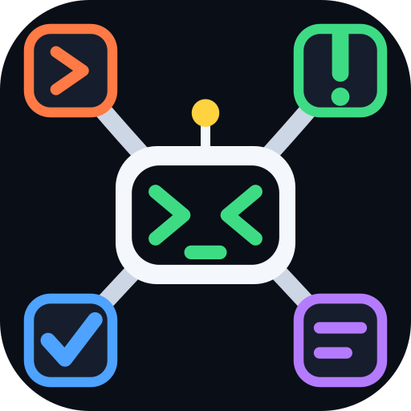

# `--json` output

Every listing and query command takes `--json`. Its output is an interface: field names and types
change only with a note in the release, and `crates/ptyro/tests/m5.rs` pins the shape of each
one with a snapshot (`crates/ptyro/tests/snapshots/m5__cli-json.snap`). `make snapshots`
accepts an intended change.

Conventions:

- **Times** are milliseconds since the Unix epoch (`*_ms`).
- **Optional fields** are `null`, or missing where noted. New fields may be added at any time,
  so ignore the ones you don't know.
- **Ids:**
  - `id` is the full session id;
  - `handle` is the shortest unambiguous suffix at the time of the call;
  - `name` is what people type.
- **Pretty-printed vs. streaming:** `--json` prints one pretty-printed document. The exceptions
  are `events --json` and `events --follow`, which print one compact JSON value per line
  (NDJSON).
- **Exit codes** don't change with `--json` (see the table at the end).

## Sessions

### `ptyro ls --json` → `[Session]`; `ptyro status S --json` → `{session: Session, explain: [ExplainLine]}`

`Session`:

| Field | Type | Notes |
|---|---|---|
| `id`, `handle`, `name` | string | |
| `kind` | string | `shell`, `command`, `agent`, `script` |
| `argv` | [string] | what runs |
| `cwd`, `live_cwd` | string | `live_cwd`: reported by the shell (OSC 7) or probed |
| `state` | `{t, …}` | `t` is `starting`, `running`, `exited` (`code`, `signal`), `failed` (`error`) or `dormant` |
| `size` | `{cols, rows}` | |
| `pid` | number? | |
| `created_ms`, `ended_ms` | number, number? | |
| `viewers` | number | clients showing it |
| `controller` | string? | client id that sizes it |
| `title` | string? | what people read: its own (`--title`, `rename --title`), else its first prompt, else the window title |
| `window_title` | string? | the window title its program set |
| `foreground` | string? | foreground process name (argv[0] when the kernel's name is a version, like Claude's) |
| `profile` | string | fixed for its lifetime |
| `worktree`, `project`, `workspace` | string? | worktree id, project id, home workspace name |
| `agent` | string? | configured agent name |
| `script` | string? | `setup` or `run:<name>` for script sessions |
| `status` | Status? | the status engine's view (below) |
| `attention` | `{kind, text, since_ms}`? | set when it wants you; `kind` is `blocked`, `errored`, `done`, `idle`, `exited` or `notification` |
| `activity` | string? | `"Bash: cargo test"` |
| `progress` | `{state, percent}`? | OSC 9;4 / 7501 progress |
| `program_status` | `{state, app, at_ms, …}`? | the raw OSC 7501 report |
| `last_command_exit` | number? | shell integration (OSC 133 D) |
| `conversation` | string? | the agent's own conversation id (resume) |
| `children` | [`{id, kind, running}`] | subagents and teammates |
| `dangerous` | bool | started with permission-skipping arguments |
| `prompt_pending` | bool | a `--prompt` waits to be typed |
| `last_prompt_ms` | number? | when ptyro last typed a prompt into it |
| `turns` | number | completed turns: the agent's own turn ends, else working → idle/done (SPEC §9.3b) |
| `last_output_ms` | number? | when its screen last changed |
| `held` | bool, missing when false | its permission prompt is held for an exact answer from any client (M9.5) |
| `structured` | string, missing when not structured | a chat's engine's protocol (`ls --chats`): `stream-json`, `app-server`, `acp` or `opencode` (M10) |
| `task` | string? | the first prompt typed into it, trimmed to 200 characters |
| `last_reply` | string? | the agent's last message once its turn ended, trimmed to 300 characters |
| `command` | `{text?, started_ms, ended_ms?, exit?}`? | a shell's running (no `ended_ms`) or last command, from the shell integration |
| `quick` | bool | its worktree's (or directory's) quick terminal (`ptyro shell`); only present when true |
| `inner_agent` | string? | the adapter of an agent started by hand in this shell, while it's in the foreground (its status is then read off its screen) |

`Status`: `{status, kind?, detail?, confidence, source, since_ms, progress?}`.
- `status` is `unknown`, `starting`, `working`, `blocked`, `idle`, `done` or `error`.
- `kind` is missing when it has no value. For `blocked` it is `permission`, `question` or `auth`;
  for `error` it is `rate_limit`, `auth`, ….
- `confidence` is `high`, `medium` or `low`.
- `source` is `process`, `hook`, `sidecar`, `osc7501`, `title`, `screen`, `notification`,
  `heuristic` or `protocol` (a chat's engine, M10).

`ExplainLine`: `{at_ms, source, signal, applied, reason}`.

`ls --all --json` returns history entries instead:
`{id, name, kind, argv, cwd, state, created_ms, ended_ms, current}`.

### `ptyro read S --json`

`{session, name, state, status?, turns, view, text}`.
- `view` is `screen` or `scrollback`.
- `state` is one word: the status, else `exited`, `dormant` or the process state.

### `ptyro wait … --json` and `ptyro send … --wait --json` → `[Outcome]`

`{session, name, reached, state, detail?, turns, matched?, waited_ms}`.
- `state` is the session's status where it ended up (`working`, `blocked`, `idle`, `done`,
  `error`, `dormant`, `exited`, …), or `removed`, `matched`, `stalled` or `timeout`.
- `matched` is the text the `--match` regex found.

### `ptyro events --json` (NDJSON, oldest first)

`{session, at_ms, kind, detail}`. The `kind` values and what each `detail` holds:

| `kind` | `detail` |
|---|---|
| `status` | `{from, to, kind, detail, source, confidence}` |
| `hook` | `{adapter, event, tool}` |
| `osc7501` | the report |
| `prompt` | `{chars}` |
| `reply` | `{chars}`: the agent's last message of a turn arrived (Claude `Stop`, Codex `notify`) |
| `answer` | `{decision}` |
| `process`, `rename`, `restart`, `resume` | |

### `ptyro events --follow` (NDJSON, live)

`{at_ms, event}`. `event` is a domain event tagged by `t`:
- sessions: `session_created`, `session_updated`, `session_exited`, `session_restarted` (each
  with `info: Session`) and `session_removed` (`id`);
- `controller_changed`, `bell`, `notification`, `notify`;
- projects and worktrees: `project_updated`/`removed`, `workspace_updated`/`removed`,
  `worktree_updated`/`removed`, `worktree_progress`;
- `alert` (a session wants you: `{session, session_name, at_ms, kind, title, body, workspace?, profile?}`; what a linked machine's daemon delivers), `usage_updated`, `config_reloaded`, `host_load` (`load`: the computer's load average, or null once `[ui] load` is off);
- `events_lost` (`count`): this stream fell behind and skipped events, so re-read state with
  `ls --json`.

## Agents

- `ptyro usage --json` → `[{profile, agent, windows: [{name, used_percent, resets_at_ms?}], cost_millis?, context_percent?, limited_until_ms?, at_ms}]`

## Projects, workspaces, worktrees, profiles

- `ptyro project ls --json` → `[{id, slug, root, default_branch?, remote_url?, pin?, created_ms, last_used_ms?}]`
- `ptyro project show P --json` → `{project, worktrees, scripts}`
- `ptyro project config P --json` → `{config, origin: {"<dotted key>": "<file>"}, imported: [{tool, file, scripts, notes}]}`
- `ptyro ws ls --json` → `[{id, name, profile, notify, projects: [project id], created_ms}]`
- `ptyro wt ls --json`, `wt status W --json` → Worktree:
  - fields: `{id, project, project_slug, name, path, branch?, base?, is_root, state, locked, profile?, created_ms, last_used_ms?, removed_ms?, status?, title?}` (`title`: what it's for, for people to read);
  - `status` is `{head, branch, upstream?, ahead, behind, base_ahead, base_behind, staged, modified, untracked, conflicts, insertions, deletions, subject, unpushed?, pushed?, at_ms}`. `unpushed` (commits on no remote, for a branch with no upstream) and `pushed` (committed work, all of it pushed, nothing uncommitted) are missing when they do not apply (UX2.2).
- `ptyro wt new … --json` → `{info: Worktree, setup?: Session, agent?: Session, agent_pending, untrusted?, notes}`
- `ptyro gc --json` → `[{worktree: Worktree, reasons: [string]}]`
- `ptyro profile ls --json` → `[{name, label, color?, defined, isolate, dirs: {agent: path}, git_email?, matches: {remotes, paths}, vars}]`
- `ptyro profile env P --json` → `{VAR: value}` (secrets as `<secret:NAME>`)

## Checkpoints (M7)

- `ptyro checkpoint ls --json` → `[{n, session, at_ms, turn, sha, ref, head, files}]`.

## Remote (M9)

- `ptyro pair -n NAME --json` → `{device: DeviceInfo, url, expires_ms, ca, machine, warning, replaces, notes}`.
  `url` always has its port. `warning` is the plain-words warning when the default scope (`full`)
  was used, null when `--scope` was named; `replaces` is the `DeviceInfo` of the existing device
  of that name that opening the link replaces (null otherwise); `notes` are fixes for a `--url`
  whose port doesn't match; `machine` is the computer's short name. `url` carries a
  one-time pairing code in its fragment (`#pair=ptp_…`), not the token: the web app trades it
  for the token (`POST /api/pair` on the web app's server) once, before `expires_ms` (10 minutes).
  `device.pending` is true until then.
- `ptyro devices ls --json` → `[DeviceInfo]`: `{id, name, scope, created_ms, last_seen_ms?,
  last_via?, push, pending}`. `scope` is `read`, `approve`, `control` or `full`; `last_via` is
  the address it last connected from; `push` counts its Web Push subscriptions; `pending`: its
  pairing code hasn't been claimed yet.

## Setup, config and the daemon

- `ptyro doctor --json`, `ptyro profile doctor --json` → `[{section, name, level, text}]`.
  `level` is `ok`, `note`, `warn` or `problem`; any `problem` makes the exit code 1.
- `ptyro about --json` → `{version, protocol, repository, issues, license, build: {commit?, date?, target}, exe?, system, places: [{name, path, exists}], daemon: {running, version?, protocol?, pid?, started_ms?, same?, fix?}, web?: {wanted, up, url?, text: [string]}, tools: [{name, kind, found, text}], report}`. `report` is the whole thing as text, for a bug report; `daemon.same` is `false`, with a `fix`, when the daemon is another version than this ptyro.
- `ptyro daemon status --json` → `{version, proto: {major, minor}, pid, started_ms, sessions, live_sessions, clients, socket, log_dir, generation, upgraded_ms, rolled_back, metrics}`; `load: {avg: [1, 5, 15 minutes in hundredths], cpus}` while `[ui] load` is on, except on Windows (which keeps no load average); inside WSL also `wsl_hold: {holding, pid, since_ms, why_not, last_exit, restarts}` (whether the daemon keeps WSL running; `why_not` says why it doesn't)
  - `generation`: live upgrades since the daemon started; `upgraded_ms`: when the last one happened (or `null`); `rolled_back`: the last upgrade was refused by the new binary and rolled back.
  - `metrics`: `{rss_kib, open_fds, tasks_alive, loop_lag_ms_max, loop_lag_ms_p99, pty_readers, bytes_read, frames_sent, crashes, scrollback_bytes, sessions: [[name, bytes]]}`. Event-loop lag covers the last minute; the totals carry across upgrades.
- `ptyro daemon upgrade --json` → `{from, to, pid, sessions, rolled_back, ms}` once the new image answers (exit 1 if `rolled_back`).
- `ptyro config check --json` → `{path, exists, ok, notes, error?, retired: [{key, removed, why}]}`
  (`retired`: keys of a removed feature the file still sets; ignored, `config unset` removes one)
- `ptyro config show --json` → the effective configuration, defaults filled in.

## Exit codes

| Code | Meaning |
|---|---|
| `0` | ok (for `wait`: the condition was met) |
| `1` | error (for `doctor`: a problem was found) |
| `2` | usage: bad arguments or values |
| `3` | not found |
| `4` | ambiguous: a name, handle or selector matched several (the message lists them) |
| `5` | conflict: unsaved work, a profile question, or (`wait`) a session exited first |
| `6` | untrusted scripts |
| `7` | timeout (`wait`, `send --wait-ready`), or `wait --stall` saw no output |
| `8` | no daemon |
| `9` | protocol mismatch: the daemon speaks another major protocol version (`ptyro daemon restart --hibernate`); within a major version, `ptyro daemon upgrade` switches it over without stopping sessions |
