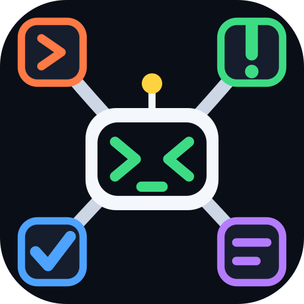

# Keys

Everything in the TUI starts with the **prefix**: `Ctrl-Q` or `Ctrl-Space`, whichever you like
(`[ui] prefix`). Press the prefix, release it, then the key. Press a prefix twice (`Ctrl-Q
Ctrl-Q`, holding Ctrl) to jump to the sidebar, the same as `Ctrl-Q Tab`. To send the prefix
itself to the program (a ptyro inside ptyro, over ssh), press the prefix and then `q`:
`Ctrl-Q q` sends `Ctrl-Q`, `Ctrl-Space q` sends `Ctrl-Space`. Hints on screen show the first
one, `Ctrl-Q`.

There are two so that one always gets through (SPEC §21.2):
- **`Ctrl-Q`**: none of Claude Code, Codex or OpenCode binds it, and it sits in the
  same place on every keyboard layout. VS Code's terminal on Linux and Windows takes it for Quick
  Open, unless you add `-workbench.action.quickOpenView` to
  `terminal.integrated.commandsToSkipShell`. Zellij's default keys quit Zellij on it.
- **`Ctrl-Space`**: on macOS it switches input sources when you have more than one, unless you
  turn that shortcut off in Keyboard settings.

To use other keys, set one or a list: `prefix = "C-]"` or `prefix = ["C-]", "C-q"]`. A list you set
replaces both defaults. `C-]` needs AltGr on some non-US layouts.

Don't know the next key? Pause after the prefix: a menu of the keys that follow appears
(`[ui] which_key_delay`, 400 ms; `0` turns it off). `.` (after the prefix, or in the sidebar, or a
right-click on a row) lists everything you can do with that session, worktree or project.
`Ctrl-Q ?` lists every binding as it is configured right now. `Ctrl-Q :` (or `Ctrl-Q C-p`) opens the palette, which runs any
action by name, finds any setting, and switches the theme (`theme ptyro-light`; kept as `ui.theme`).

## After the prefix

| Key | Does |
|---|---|
| `?` | help: every key |
| `:` or `C-p` | command palette |
| `d` | detach (sessions keep running) |
| `q` | send the prefix key itself to the program (`Ctrl-Q q` types `Ctrl-Q`): for a ptyro inside ptyro, emacs's `C-q`, or a program that quits on it |
| `C-d` | quit ptyro: stop every session and the daemon, after a yes (agents hibernate and resume next time) |
| `n` | new task: say what to do, ⏎ starts the default agent on it in a new worktree named after it (Tab edits the name, `C-o` picks the agent and where, an empty ⏎ is a random name) |
| `C-n` | quick new: another of the agent this worktree last started (`claude`, `codex@work`…, with its arguments) in this worktree, no questions; where none has run, the project's default agent, else the Default agent setting (claude). Always an agent: `!` is the shell. The which-key menu says what it starts: `+ claude` |
| `N` | new worktree of this project (+ an agent), after its setup script |
| `w` | go to a workspace: every workspace (yours, then other machines') is in the sidebar, and this jumps to its header, unfolded; `+ new workspace` asks which machine when there are others |
| `o` | open the worktree in an editor (`[editors]`; nvim opens inside ptyro) |
| `r` / `R` | run the project's default run script / pick a lifecycle script |
| `a` | jump to the session that needs you most (blocked first) |
| `p` | peek at the session that needs you most (else this one) and answer it without switching |
| `b` | broadcast one prompt into every session marked with `Space` in the sidebar |
| `m` | a new chat with your agent, in this workspace, over the panes: type, `⏎` sends, `C-o` picks the agent (SPEC §22) |
| `g` | the chat list: this workspace's chats by day (`Tab`: every workspace's), `/` searches (titles at once, every message from 3 letters on, on every machine), `⏎` opens (a message hit: at that message), `*` pin, `x` archive, `X` delete, `,` rename (its title), `e` export, `A` archived ones |
| `C-g` | search every chat: the chat list, every workspace and machine, typing its search |
| `j` / `k` (or `Down` / `Up`) | show the next / previous session of the workspace in this pane, in sidebar order, across projects (quick terminals are skipped) |
| `1` … `9` | show the session numbered N in the sidebar in this pane |
| `/` | find a session (fuzzy) |
| `` ` `` | back and forth: from a chat to the session under it and back to the chat (as you left it, draft and all); else the split that something new covered (whole, as you left it); else the session this pane showed before |
| `v` / `s` | split beside / below, then pick what goes there: `⏎` a clone of this pane's session (the same agent and profile in the same worktree, a fresh conversation; a shell gets a shell in its directory), `+ new shell` (beside an agent: a shell in its worktree), or any session not on screen (type to filter) |
| `h` / `l` | previous / next pane |
| `Shift`+arrows | the pane in that direction |
| `z` | zoom this pane (toggle) |
| `c` | close this pane (the session keeps running) |
| `<` `>` `+` `-` | narrower / wider / taller / shorter |
| `Tab` | move focus between the sidebar and the pane |
| `C-q` or `C-Space` | the prefix again: the same as `Tab` (a prefix you set in `[ui] prefix` does it too) |
| `\` | show or hide the sidebar |
| `u` | do what the last message offers: undo it, or fix what it reports |
| `!` | a new shell of its own in this worktree, full sized (every press starts another; the quick terminal is `C-t` / `T`). With no worktree around (an empty pane, a shell of SHELLS), a shell in SHELLS |
| `C-c` | a new shell in the workspace's **SHELLS**, in the pane's directory, full sized (tmux's `c`) |
| `e` | the shells menu: the workspace's SHELLS by number; a digit shows one, `c` a new shell, `!` a command (`htop`, `ssh prod`), `s` a scratch shell. `C-q e 3` works where Alt doesn't |
| `C-t` | this worktree's quick terminal (one per worktree) in a drawer below a pane of its project (VS Code's toggle). Again focuses it, and once more hides it (the shell keeps running). When none of the project is open it is a panel of its own, and a note says so. With no worktree here it asks for a project first |
| `T` | this worktree's quick terminal full sized. Again goes back |
| `H` | home: who needs you, recent projects and repositories found; ⏎ starts a task there |
| `M` | mend: what the health badge (`⚕` in the status bar) found, each with its fix |
| `U` | set up agents and tools: the setup checklist (Agents, Tools, Already here). `Space` ticks, `⏎` installs what's ticked in a split (live output, sudo's prompt there, then the logins), `s` not now. The first run opens with the same checklist at its top |
| `^` | update: your agents and ptyro itself, when newer versions are out (looked for once a day), in a split. It shows each update's command and asks first; ptyro's own is checked against its SHA256SUMS, the daemon upgrades live, and every open TUI restarts into the new ptyro with its view kept |
| `G` | clean up: stale worktrees (merged or squash-merged, gone or unused), biggest on disk first; `⏎` removes one, after a yes (it refuses to lose work, saying what it would lose: `y` removes it anyway, `n` keeps it); `C-k` keeps one: it isn't offered again until it is unused for another `worktrees.stale_days`, or its branch moves on. The health badge says when there are some |
| `L` | the Library: everything ptyro kept of your work (agent sessions), and your chats, searched and read in one place; with nothing typed, the history by day. Its keys are under [The Library](#the-library-ctrl-q-l). Again closes it |
| `I` | about ptyro: its version and protocol, the repository and where to report a problem (links: `⏎` opens, `y` copies), where config, data, logs and the socket live, whether the daemon and the web app run (`U` switches a daemon of another version to this one), the tools found, and `c` copies all of it for a bug report |
| `C` | settings: every option, searchable, edited in place (`/` search · `m` only what you changed · `u` undo · `r` reset · `n` add · `d` remove · `R` rename · `s` save a repository's settings to the shared file · `!` restart the daemon when a setting needs it) |
| `.` | what you can do with the focused session (its menu) |
| `P` | add a project (pick from the repositories ptyro found) |
| `Z` | everything at once: the sidebar fills the screen with every row open (`⏎` opens one; `C-q Z`, `z` or `Esc` goes back) |
| `C-z` | fold the whole sidebar (as `Z` does in the sidebar); again: unfold it as it was |
| `f` | the sidebar's filter: all → running → active → all (also a click on a chip under its title; `sidebar.show_all`, `sidebar.show_running`, `sidebar.show_active` in the palette) |
| `[` / `PageUp` | copy mode / copy mode, one page up |
| `]` | paste what you last copied |
| `x` / `X` | stop the session: an agent's turn is interrupted and it gets a moment to exit, then it's signalled (an exited one is removed instead; a shell that exits is removed by itself, `[ui] shell_exit = "keep"` leaves it) / kill it now (SIGKILL). Both ask first unless `[ui] confirm_kill = false`, and both keep it listed; Stop and remove (`session.remove`, its row menu) forgets it too. The pane moves on to the nearest other session (`[ui] on_stop`); `` ` `` brings the stopped one back |
| `C-r` | run an exited session's command again |
| `,` | rename the session: its name, the address you type to find it; `C-t` in the dialog edits its title instead, what people read |
| `=` | take control: size the session to your pane (when another client resized it) |
| `C-l` | redraw everything |

`Ctrl-Z` (no prefix) goes to the program. An agent run directly in a session has no shell to
`fg` it back, so when it suspends itself (Claude does), ptyro resumes it straight away and
says so.

**SHELLS, with no prefix:** `Alt-1` … `Alt-9` show shell 1–9 of the workspace's SHELLS, and
`Alt-0` shell 10 (SPEC §23). An empty number starts a shell there, here, so a number is also the
key that makes it. They work in a pane and in the sidebar: Alt-digits don't reach the program
in the pane while they're bound (readline's `digit-argument`, irssi's and weechat's windows), and
`[shell] alt_digits = false` (Configuration → Shells) gives them back. **On the web** the same
`Alt+1`…`Alt+9`, `Alt+0` work from any page, a terminal you are typing in too (and don't reach its
program); Option on a Mac works as Alt there with no setting, except where Option types one of the
layout's own characters (`[`, `#`), and so does a keyboard whose digit row types `& é "…` (French
AZERTY on Windows and Linux); plain `1`…`9` work on the list and a shell you only watch. On macOS, Terminal.app and
iTerm2 type `¡™£` for Option-digit unless Option is set to act as Meta (Terminal.app: Settings →
Profiles → Keyboard → "Use Option as Meta key"; iTerm2: Profiles → Keys → Left Option key: Esc+).
Until then the hints say `C-q e 1…9`, which always works. `make verify-shells` shows what your
terminal sends. Once any key with Alt arrives, ptyro knows Alt works here and the hints say
so; Option-digit arriving as `¡™£` is pointed out once, and the health badge (`M`) says where the
setting is. A shell's pane header is the strip of its workspace's shells, the shown one in
brackets: a click on a number shows that shell, a click on `＋` starts one.

In a pane whose session has exited, `⏎` runs it again; in a dormant one, `⏎` resumes it.

**Splits.** You make a split with `v` (beside) or `s` (below), and choose what goes in it: `⏎`
takes a clone of the pane's session, `+ new shell` a shell next to an agent, or type to pick any
session. A session you pick later (`⏎` in the sidebar, `/`, `1`–`9`, `j`/`k`, `a`) shows in the
focused pane, so the split stays. Something new opens full sized: a new session (`n`, `C-n`,
`!`, the wizard), the quick terminal's panel, a tool (an editor, a command's output, `config
edit`). The split it covers is **kept**: `` Ctrl-Q ` `` brings it back whole, as you left it, and
`` ` `` again returns to the new thing; picking one of the kept split's sessions brings it back
too. An editor you opened from ptyro gives its screen back on its own when you quit it.

An agent with a shell beside it:

1. Show the agent (`⏎` on it in the sidebar).
2. `Ctrl-Q v`, then `+ new shell` (or the name of a shell you already have) and `⏎`.
3. `Ctrl-Q h` / `l` moves between them; `Ctrl-Q z` zooms one; `Ctrl-Q c` closes a pane (its
   session keeps running). Drag the divider to resize.

For the worktree's one quick shell under the agent instead, `Ctrl-Q Ctrl-T` opens it in a drawer.

## In the sidebar

Focus the sidebar with `Ctrl-Q Tab`, or `Ctrl-Q Ctrl-Q`. These keys need no prefix there.

| Key | Does |
|---|---|
| `j` / `k`, `g` / `G` | next / previous, first / last |
| `⏎` | open the session, or fold and unfold a workspace, project or worktree |
| `h` / `l` (or `Left` / `Right`) | fold / unfold |
| `Space` | mark a session for broadcast; on a workspace, project or worktree, fold or unfold |
| `b` | broadcast one prompt into the marked sessions |
| `n` / `C-n` / `N` | new task here / quick new (another of this worktree's agent, here) / new worktree |
| `a` `p` `e` | next attention / peek / why this status |
| `x` / `X` | stop a session (on an ended one: remove it; a dormant one asks first) or remove a worktree (refuses to lose work, saying what: `y` removes it anyway, `n` keeps it) / kill a session now. Its pane shows the next session |
| `R` | restart an exited session |
| `,` | rename |
| `m` / `*` | a new chat / pin the chat row. On a chat row `⏎` opens it, `,` titles it, `x` archives it (an archived one comes back), `X` deletes it (asks), `f` forks it, `.` its menu; `⏎` (or Space) on the CHATS heading folds it, as `h`/`l` do, and a click on its `＋` starts a chat in that workspace; `all chats…` (or `C-q g`) lists them |
| `z` | everything at once: the sidebar full-screen, every row open |
| `Z` | fold everything: every workspace, project, worktree and CHATS section, so the sidebar is one line a workspace (the selection moves to the row it folded into); `Z` again unfolds it as it was before, and whatever arrived meanwhile opens too |
| `f` | filter the list: all → running → active (a machine, project or worktree with nothing running under it is hidden) |
| `<` / `>` | the sidebar a column narrower / wider (or drag its edge) |
| `u` / `P` | do what the last message offers / add a project |
| `.` | everything you can do with this row (a session, worktree or project), with the keys |
| `!` | a new shell in this worktree, full sized |
| `c` | a new shell in SHELLS, in the selected row's directory (on a SHELLS heading: that workspace's) |
| `C-t` / `T` | its quick terminal in a drawer / full sized (`⏎` on its `›_ quick shell` line shows or hides it too) |
| `H` / `M` / `I` / `U` / `^` | home / mend what the health badge found / about ptyro / set up agents and tools / update them and ptyro |
| `L` | the Library: what was kept of your work, and your chats, to search and read (a session's, a worktree's and a project's menu, `.`, has `kb.history`: only that one's) |
| `w` `o` `r` | workspace / editor / run script |
| `v` `s` | split |
| `1` … `9`, `/` | jump to a session / find one |
| `?` `:` `\` | help / palette / hide the sidebar |
| `Tab` or `Esc` | back to the pane |

## Peek and permission prompts

In peek (`Ctrl-Q p`), with nothing typed and the session blocked, `y` allows a permission
prompt, `a` always allows, `n` denies. Or type a reply and press `⏎`. `⏎` with nothing typed
switches to the session; `Esc` closes peek.

## Chats (`Ctrl-Q m`, `Ctrl-Q g`)

The chat view takes the place of the panes; the sidebar stays. Type and `⏎` to send
(`Shift-⏎` or `Ctrl-J` for a new line), `PageUp`/`PageDown` (or the wheel) to scroll, `Ctrl-C`
stops an answer being written (with none, it clears the draft), `Esc` goes back: to the chat list
it was opened from. Each chat
keeps its draft while you are elsewhere. On a permission card, with nothing typed, `a` allows,
`A` always, `d` denies; any other letter is typed. `Ctrl-Q .` is the chat's menu: everything below
that applies to it (a new chat's: its agent, folder, incognito). While the chat (or the
list) is shown, `Ctrl-Q ,` `x` `X` mean its title, archive and delete, never the session under it.
A chat searches the web and reads the folders it was given; the header names its folders, and
says `best effort` where its agent can't enforce that by itself.

| Key | Does |
|---|---|
| `Ctrl-F` | find in this chat; again: the next match; `Esc` clears it |
| `Tab` or `Ctrl-I` | in a new chat, before its first message: incognito (nothing kept, it ends with its agent) |
| `Ctrl-O` | in a new chat: pick the agent, then a folder it may read; in a chat: switch its agent |
| `↑` / `↓` | in a draft of several lines: the line above / below |
| `←` / `→`, `Home` / `End` or `Ctrl-A` / `Ctrl-E` | move in the draft (to the start or end of the cursor's line) |
| `Ctrl-U` / `Ctrl-K` | delete to the start / the end of the cursor's line |
| `Ctrl-W` / `⌫` / `Delete` | delete the word before the cursor / the character before / the one under it |
| `@` then `↑`/`↓`, `Tab` or `⏎` | the chat's folders that match what follows the `@` (shown in the composer): choose one, put it in |

Slash commands, typed into the composer: `/retry` (a new answer replaces the last one),
`/edit [text]` (say your last message differently: it and its answer are replaced; only the last
one), `/agent NAME`, `/folder DIR` (one more
folder it may read; `/folder none` takes them away; in a new chat, before its first message, too),
`/task [PROJECT] [--agent A] [--name N]` (an agent carries the chat out in a new worktree; it asks which project when it
can't tell; `--agent` another agent than the chat's, `--name` the worktree's name), `/title TEXT`, `/search WORDS`, `/find QUESTION`, `/export`, `/incognito`, `/cite`
(open a citation), `/help` (the list: ⏎ puts one in the composer). `/agent NAME` and `/title TEXT`
work in a new chat too, before its first message. Each is also an action in the palette (`chat.*`).

The chat list (`Ctrl-Q g`): `j`/`k` move, `⏎` (or a click) opens (a message hit: at that
message), `/` searches (`⏎` opens what is selected), `m` new, `*` pin, `x` archive, `X` delete,
`,` title, `e` export, `s` only the chats that need you, then working, unread, pinned,
then all, `A` archived ones, `Tab` every workspace (again: back to
the one it was opened for), `.` the menu, `Esc` closes. The selected chat shows its last question
and answer under it.

Every key in this section, the view's and the list's, is in the key map: the `chat` and
`chatlist` tables, rebound in `[keys]` as `"chat:C-f" = "chat.find_in"` or `"chatlist:p" =
"chat.pin"` (`"none"` unbinds), and in the settings panel's Keys section. The hints on screen
show the keys as they are bound.

## The Library (`Ctrl-Q L`)

What ptyro kept of your work (your agents' sessions, as they happen) and your chats, in one
panel over the panes, like the chat list. With nothing typed it is **the history**, by day;
type and it is **a search**. The selected row's text is beside the list (on a terminal too
narrow for both, the list is alone and a hit shows more of its text).

| Key | Does |
|---|---|
| `/` (or `i`) | type in the search box: words (all must match), `"a phrase"`, `prefix*`, `-word`, `before:30d`, `agent:codex`, `machine:laptop2`, `by:meaning`. Hits come as you type, from 3 letters. `⏎` or `↓` goes to the hits, `Esc` empties the box (the history again), `C-u` clears it |
| `j` / `k`, `↓` / `↑`, `PgDn` / `PgUp`, `g` / `G` | move (the wheel too; a click selects) |
| `Tab` | the filters: kind, project, since, and with linked machines the machine (`any`: a search asks every one that is up, and the history is this computer's; `here`: this computer only; or one of them). `←` / `→` (or `Tab`) move among them, `⏎` picks from a list, `Backspace` clears one, `Esc` goes back to the list |
| `⏎` | open it: a chat's hit in the chat, at that message (`Esc` there comes back); anything else in **the reader** |
| `r` | go to the session it happened in (a dormant one is resumed; an exited one is shown, where `⏎` restarts it). `` Ctrl-Q ` `` comes back to the Library |
| `y` / `Y` | copy its address (`k:7f3k/12`) / its text |
| `d` | forget it: the daemon says what will go and asks; then its text is deleted for good and never kept again (a chat is deleted from the chat list instead) |
| `s` | how the knowledge base stands, as `ptyro kb` says it; again shows the selected row's text |
| `Backspace` | in a row's history (`kb.history`): everything again |
| `Esc` / `q` | close |

**The reader** shows an item's stored pieces as a transcript, read only, at the piece you
opened: `j` / `k`, `PgUp` / `PgDn`, `Space`, `g` / `G` and the wheel scroll, `/` finds in it
(`n` / `N` the next one and the one before), `r`, `y`, `Y` and `d` as in the list, `Esc` goes
back to the list.

**With linked machines**, a hit of another machine has its name on its row, and is read,
gone to (`r`) and forgotten there; a machine that didn't answer is named under the hits.

**Switched off** (`[kb] enabled = false`), the Library says so and `⏎` switches it on. The
actions (`kb.open`, `kb.search`, `kb.recent`, `kb.history`, `kb.show`, `kb.forget`, `kb.status`,
`kb.enable`) are in the palette, and `Ctrl-Q .` in the Library lists them. `kb.show` and
`kb.forget` from the palette, with nothing selected, ask for an address. The keys inside the
Library are fixed; `Ctrl-Q L` itself is rebound like any other (`L = "kb.open"` in `[keys]`).

## Several lines in one prompt

Enter sends a prompt. To start a new line instead:

| Where | New line | Notes |
|---|---|---|
| An agent's pane (Claude Code, Codex) | `Shift+Enter`, `Alt+Enter`, `Ctrl+J`; in Claude also `\` then Enter | All four verified through ptyro (Claude Code 2.1.309, Codex 0.164, 2026-10-23). |
| ptyro's own boxes: the task box, peek's reply, a broadcast | `Shift+Enter`, `Alt+Enter`, `Ctrl+J` | The box grows as you type (up to a third of the screen), and a paste keeps its new lines. Names, titles and command lines stay on one line. The hint line names the key your terminal can send. |
| `ptyro send` | a real new line in the text: `ptyro send s $'line 1\nline 2'`, or a quoted string over two lines | Multi-line text is pasted, bracketed when the program asked for it, so nothing is sent early. Enter is pressed once afterwards (not with `--no-enter`). |
| The web app | `Shift+Enter` | Enter (or Send) sends. |

`Shift+Enter` needs a terminal that tells it apart from Enter, which the TUI asks for with the
kitty keyboard protocol. That works in Ghostty, kitty, WezTerm, foot, iTerm2 3.5+ and Alacritty
0.13+; `Ctrl-Q ?` shows whether it's on. Elsewhere (Terminal.app, older terminals) `Shift+Enter`
arrives as a plain Enter and sends. Use `Ctrl+J`, which works everywhere, or `Alt+Enter` (on
macOS, turn on "Use Option as Meta key" in Terminal.app, or "Esc+" for the left Option key in
iTerm2). Inside tmux, `set -g extended-keys on` lets `Shift+Enter` through. VS Code's terminal
needs Claude's `/terminal-setup` (it binds `Shift+Enter` to send `\` then Enter, which works
through ptyro too).

## Copy mode

`Ctrl-Q [` freezes the scrollback so you can read it while output continues.

| Key | Does |
|---|---|
| `h j k l w b e 0 ^ $`, arrows, `Home` / `End` | move (a count works: `5j`) |
| `H` / `M` / `L` | top / middle / bottom of the screen |
| `gg` / `G` | top / bottom (`gg` at the top loads older history from the recording) |
| `C-u` / `C-d`, `C-b` / `C-f` (`PageUp` / `PageDown`), `C-y` / `C-e` | half page / page / line |
| `/` / `?`, then `n` / `N` | search forward / backward, next / previous match |
| `[` / `]` (or `{` / `}`) | previous / next shell prompt (bash, zsh, fish and PowerShell sessions) |
| `v` / `V` / `C-v` | select characters / lines / a block (`o` jumps to the other end) |
| `y` or `⏎` / `Y` | copy the selection / the line to your terminal's clipboard (works over SSH and in tmux) |
| `q`, `Esc` or `C-c` | leave (`Esc` first clears a selection) |

## Mouse

- Wheel up to scroll back.
- Drag to select (copied on release). Hold `Shift` for the terminal's own selection, or set
  `[ui] mouse = false`.
- Click to focus. Clicking a workspace, project or worktree row folds it. Right-click a row for its menu.
- Drag a divider to resize panes, or the sidebar's edge to resize the sidebar. Either is saved
  with the workspace's layout.

## The palette

`Ctrl-Q :` runs any action by name, goes to any session, worktree or project, and runs the
current project's scripts; each line shows its key, so it teaches them. Actions with no default
key include: `project.add`
(pick from repos under `[discover] roots`), `project.trust`, `worktree.remove`,
`session.command` (a session running a command line), `session.resume`, `session.hibernate`,
`session.mute`, `session.private` (forget what the knowledge base kept of a session and keep
nothing more of it), `notify.test`,
`config.edit`.

## Other overlays

- **Trust** (a project's scripts): `y` trusts, `n` goes on without them, `j` / `k` scroll.

## Rebinding

**Every key can be changed from Settings** (`Ctrl-Q C`, then Key bindings; on the web, More →
Settings → Key bindings). It lists every key, the defaults too, in three groups (after the
prefix, in the sidebar, anywhere), each with what it does in plain words and where it stands:
`default`, `yours` (a key of your own), `changed` (a default that runs something else) or
`unbound`. Press `⏎` on one for the choices: **change its key** (press the new one; if it is
taken you are told what runs there and asked before the two swap), **change what it runs** (a
list you can search by name or by what the action does), **unbind** it (it stays listed, so
you can bring it back) or **back to the default**. `d` unbinds, `r` resets, `u` undoes, and
`/` finds a key by what it does (`detach`, `settings`). `+ Add a key…` makes a new one. The
nine digit keys that show sessions 1 to 9 are one row; bind a key of your own to
`session.focus` and a number to add more.

From a script: `ptyro config list keys` shows every key (`--changed`: only the ones that
differ from the defaults), `ptyro config get keys.d` what one runs,
`ptyro config set keys.y pane.zoom` binds, `ptyro config set keys.d none` unbinds a default and
`ptyro config unset keys.d` puts it back. In the file, only what differs from the defaults is
kept:

```toml
[keys]
"y" = "pane.zoom"                    # after the prefix
"global:M-1" = "session.focus 1"     # no prefix needed
"nav:J" = "nav.down"                 # in the sidebar
```

`"none"` unbinds a key, so a default can be switched off. The action names are the ones `Ctrl-Q ?` shows (the palette leaves out `nav.*` and
`session.focus N`). Every CLI command has one ([`parity.md`](parity.md) lists them); the
ones that run a `ptyro` command do so in a split below, asking for what they need first.
