# ptyro logos

Fifty concepts (01–10 lean on the flame; 11–20 steer clear of fire; 21–30 are about many agents at once; 31–40 are the merge train; 41–50 are pterodactyls), each as a wide **logo** (1200×400) and a square **icon** (512×512), in SVG and PNG. Riffs on the shortlist are in [`riffs/`](riffs/README.md). Generated by `scripts/logos.py`; run `make logos` to rebuild (PNGs need `rsvg-convert`). The wordmark is drawn, not typeset, so no fonts are needed.

## 01. Prompt Flame

A flame with a `>_` prompt cut out of it: the terminal, on fire.

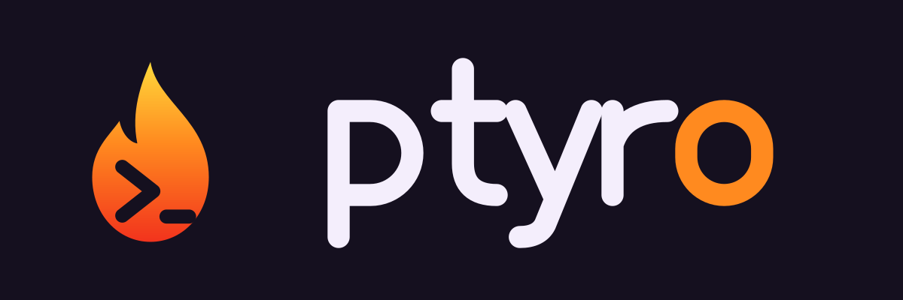 

`01-prompt-flame-logo.svg` · `01-prompt-flame-logo.png` · `01-prompt-flame-icon.svg` · `01-prompt-flame-icon.png`

## 02. Pixel Flame

The flame, drawn in terminal cells.

 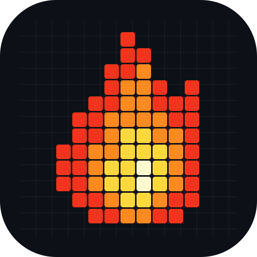

`02-pixel-flame-logo.svg` · `02-pixel-flame-logo.png` · `02-pixel-flame-icon.svg` · `02-pixel-flame-icon.png`

## 03. Fork Y

The `y` is a git fork: one trunk, three worktrees, one of them burning.

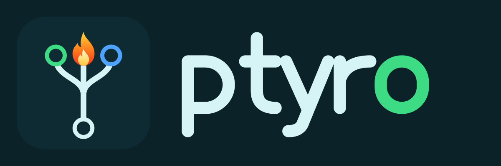 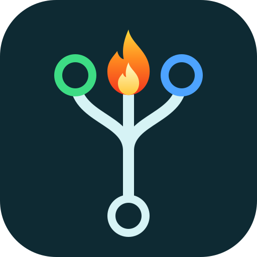

`03-fork-y-logo.svg` · `03-fork-y-logo.png` · `03-fork-y-icon.svg` · `03-fork-y-icon.png`

## 04. Strike a Match

Every agent starts with a spark. The match head is a block cursor.

 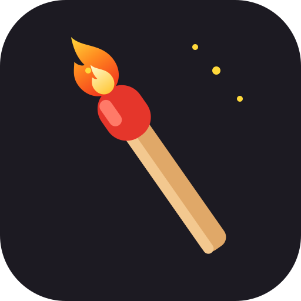

`04-match-logo.svg` · `04-match-logo.png` · `04-match-icon.svg` · `04-match-icon.png`

## 05. Fireworks

Pyrotechnics: a burst of agents (four colours, one prompt in the middle).

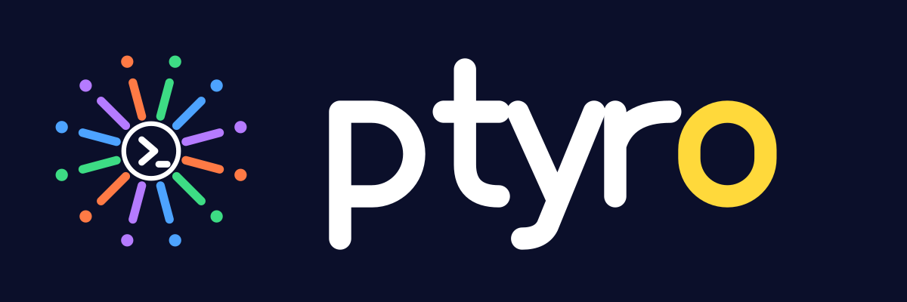 

`05-fireworks-logo.svg` · `05-fireworks-logo.png` · `05-fireworks-icon.svg` · `05-fireworks-icon.png`

## 06. Four Panes

Four sessions side by side, each with its status colour.

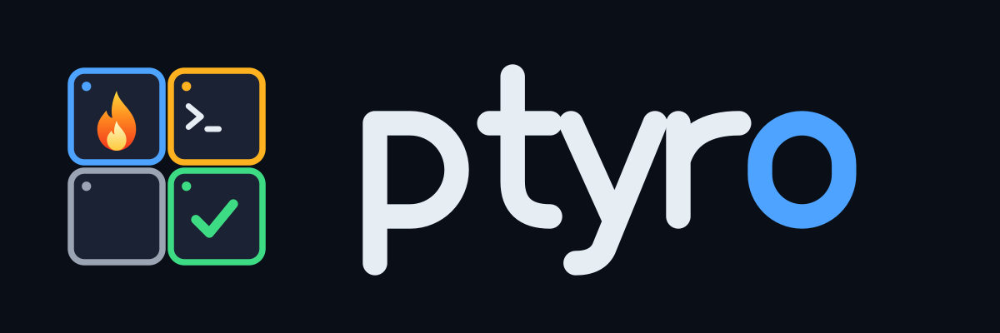 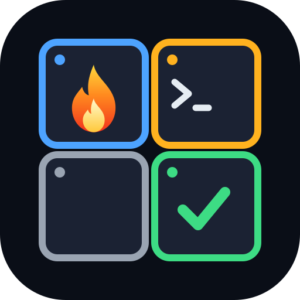

`06-four-panes-logo.svg` · `06-four-panes-logo.png` · `06-four-panes-icon.svg` · `06-four-panes-icon.png`

## 07. Phosphor

A green-phosphor CRT, because it is a terminal after all.

 

`07-crt-logo.svg` · `07-crt-logo.png` · `07-crt-icon.svg` · `07-crt-icon.png`

## 08. The Daemon

A little pixel imp: the background daemon that keeps your agents alive.

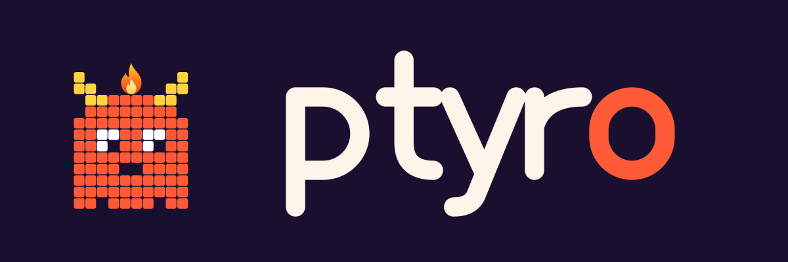 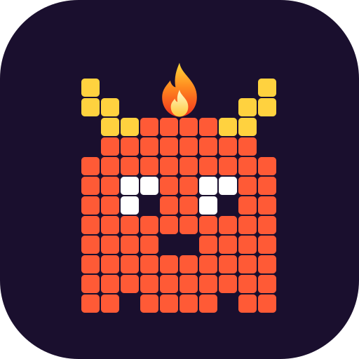

`08-daemon-logo.svg` · `08-daemon-logo.png` · `08-daemon-icon.svg` · `08-daemon-icon.png`

## 09. Campfire

Agents gather round the fire; you can leave and it keeps burning.

 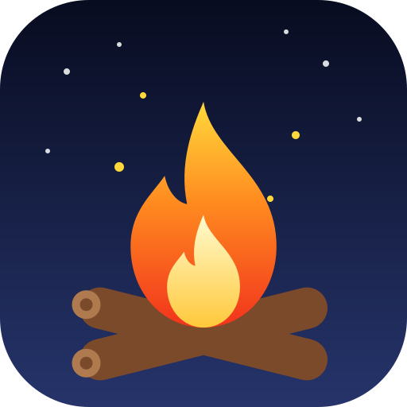

`09-campfire-logo.svg` · `09-campfire-logo.png` · `09-campfire-icon.svg` · `09-campfire-icon.png`

## 10. Status Ring

Working, blocked, idle, done: the four states around one flame.

 

`10-status-ring-logo.svg` · `10-status-ring-logo.png` · `10-status-ring-icon.svg` · `10-status-ring-icon.png`

## 11. Pty Pair

A pty is two ends of one pipe: the master and the slave, a prompt and its cursor.

 

`11-pty-pair-logo.svg` · `11-pty-pair-logo.png` · `11-pty-pair-icon.svg` · `11-pty-pair-icon.png`

## 12. Ptero

p-t-y-ro, say it fast: a pterodactyl, wings spread over your terminal.

 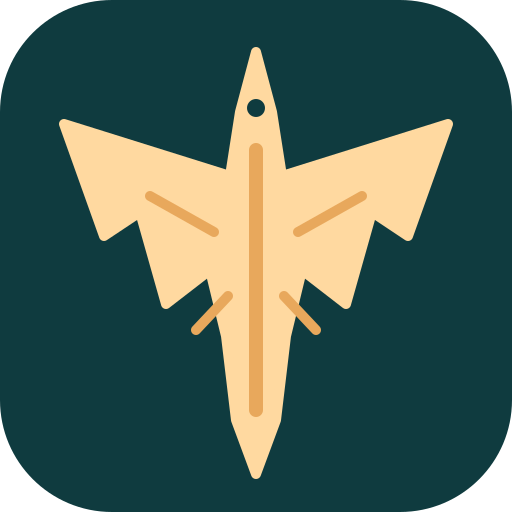

`12-pterodactyl-logo.svg` · `12-pterodactyl-logo.png` · `12-pterodactyl-icon.svg` · `12-pterodactyl-icon.png`

## 13. Octopus

Eight arms, eight sessions, one cheerful head keeping track of all of them.

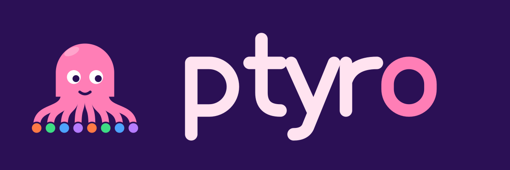 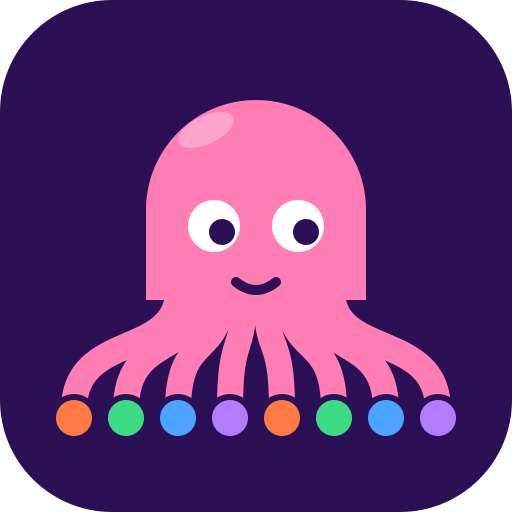

`13-octopus-logo.svg` · `13-octopus-logo.png` · `13-octopus-icon.svg` · `13-octopus-icon.png`

## 14. Lighthouse

One beam sweeping the dark to show which agent needs you.

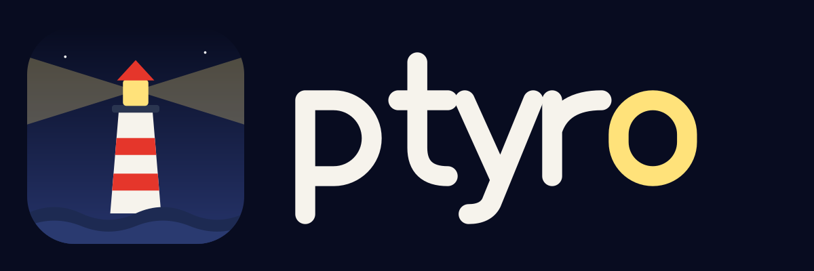 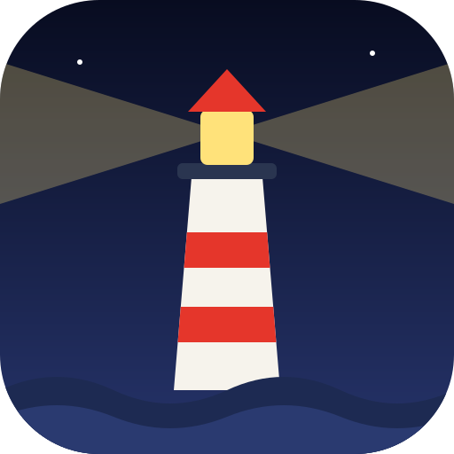

`14-lighthouse-logo.svg` · `14-lighthouse-logo.png` · `14-lighthouse-icon.svg` · `14-lighthouse-icon.png`

## 15. Constellation

Sessions as stars, joined into a p.

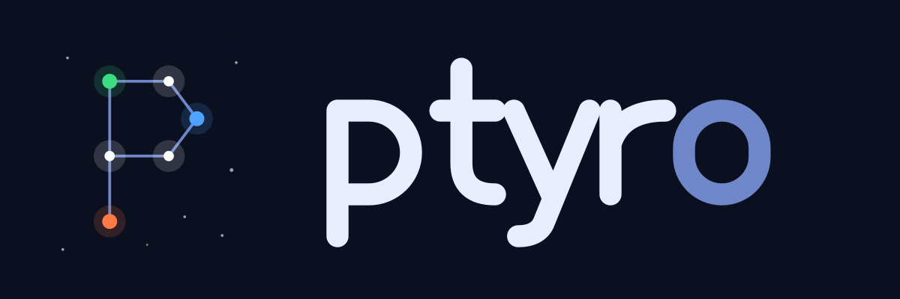 

`15-constellation-logo.svg` · `15-constellation-logo.png` · `15-constellation-icon.svg` · `15-constellation-icon.png`

## 16. Honeycomb

A hive of workers: one cell per agent, one key to the cell that is buzzing.

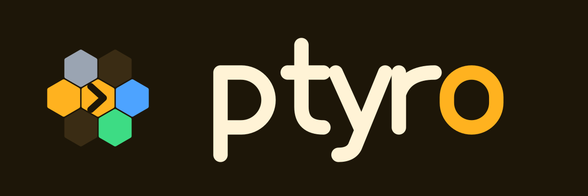 

`16-honeycomb-logo.svg` · `16-honeycomb-logo.png` · `16-honeycomb-icon.svg` · `16-honeycomb-icon.png`

## 17. Friendly Robot

A robot whose face is a prompt and a smile: `> <`.

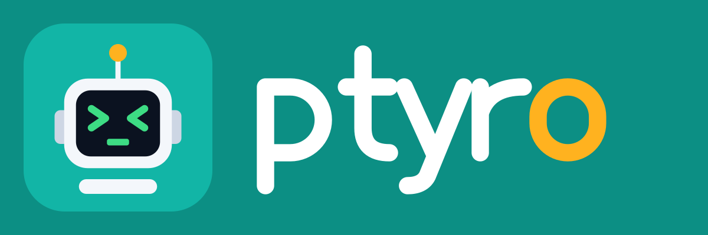 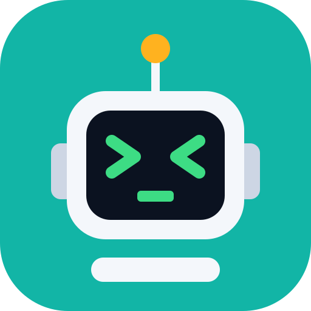

`17-robot-logo.svg` · `17-robot-logo.png` · `17-robot-icon.svg` · `17-robot-icon.png`

## 18. Radar

A sweep, four blips, one of them amber: an agent is blocked on you.

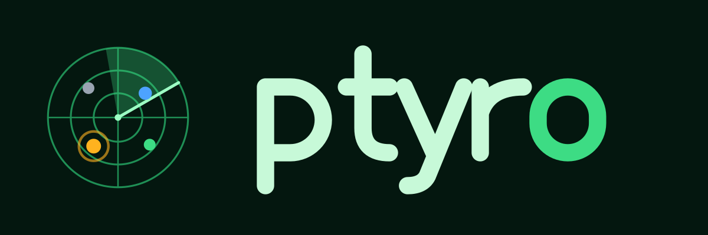 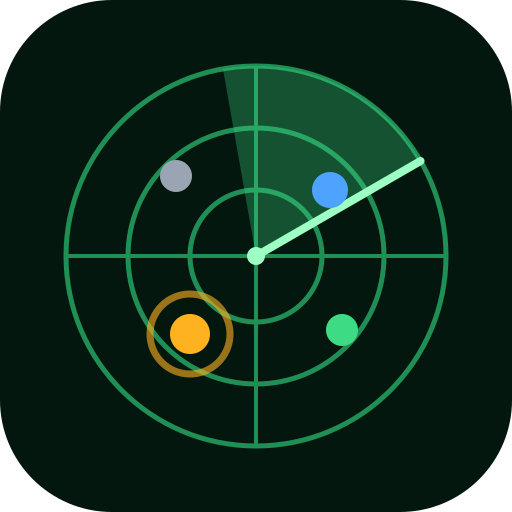

`18-radar-logo.svg` · `18-radar-logo.png` · `18-radar-icon.svg` · `18-radar-icon.png`

## 19. Orbit

Four agents in orbit around one planet of code.

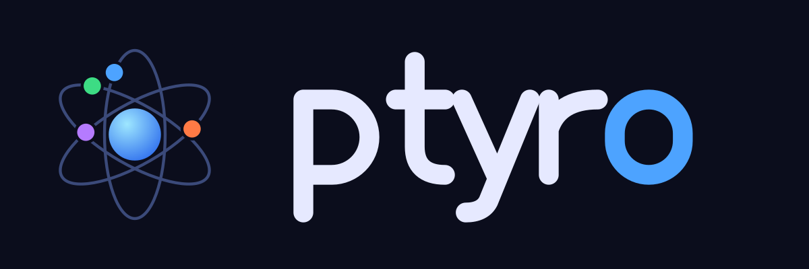 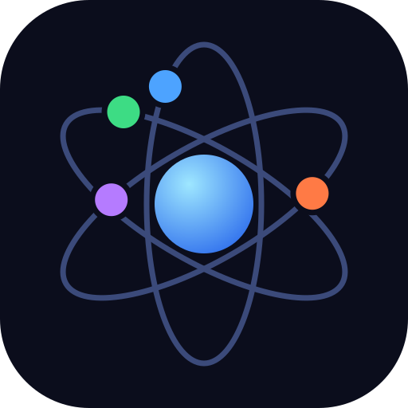

`19-orbit-logo.svg` · `19-orbit-logo.png` · `19-orbit-icon.svg` · `19-orbit-icon.png`

## 20. Turtle

Slow and steady, and it never loses its home: the shell is a terminal.

 

`20-turtle-logo.svg` · `20-turtle-logo.png` · `20-turtle-icon.svg` · `20-turtle-icon.png`

## 21. Flock

A flock in formation: one lead, six following, all heading the same way.

 

`21-flock-logo.svg` · `21-flock-logo.png` · `21-flock-icon.svg` · `21-flock-icon.png`

## 22. Hub and Spoke

A lead agent in the middle, workers around it: orchestration in one picture.

 

`22-hub-logo.svg` · `22-hub-logo.png` · `22-hub-icon.svg` · `22-hub-icon.png`

## 23. Chain

Four chevrons, four agents: the output of one is the prompt of the next (recipes).

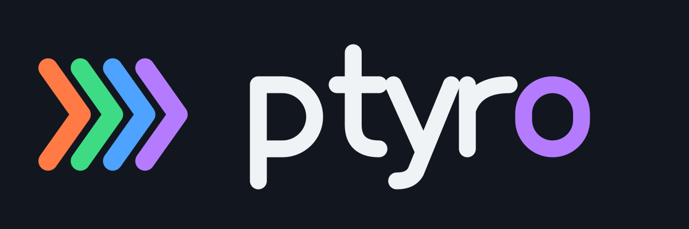 

`23-chain-logo.svg` · `23-chain-logo.png` · `23-chain-icon.svg` · `23-chain-icon.png`

## 24. Fan Out

One task fans out to many agents, you pick the best, and it comes back as one.

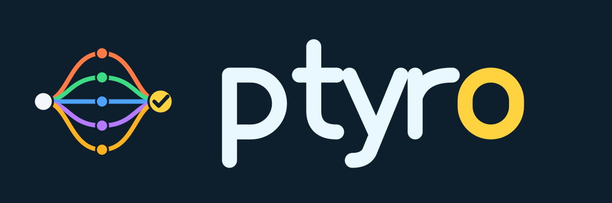 

`24-fan-logo.svg` · `24-fan-logo.png` · `24-fan-icon.svg` · `24-fan-icon.png`

## 25. Squad

A pixel crew of four, one colour each.

 

`25-squad-logo.svg` · `25-squad-logo.png` · `25-squad-icon.svg` · `25-squad-icon.png`

## 26. Merge Train

Each agent's change is a car; the train rolls into main in order.

 

`26-merge-train-logo.svg` · `26-merge-train-logo.png` · `26-merge-train-icon.svg` · `26-merge-train-icon.png`

## 27. Overlap

Many agents, one shared prompt in the middle.

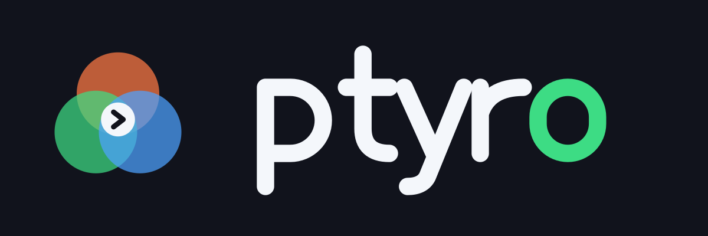 

`27-venn-logo.svg` · `27-venn-logo.png` · `27-venn-icon.svg` · `27-venn-icon.png`

## 28. Bento

A tiled workspace: the big pane you work in, the small ones that report status.

 

`28-bento-logo.svg` · `28-bento-logo.png` · `28-bento-icon.svg` · `28-bento-icon.png`

## 29. Ducks in a Row

Get your ducks in a row: a lead duck and four followers.

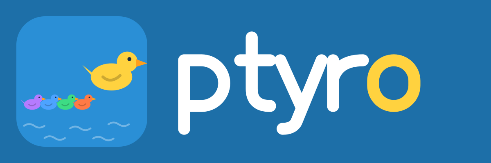 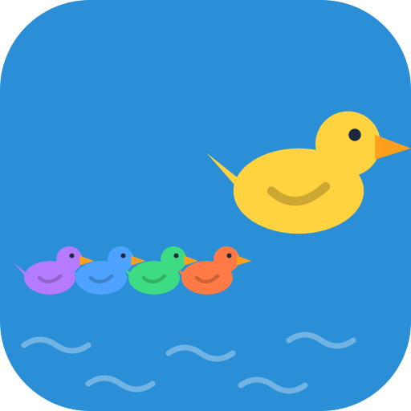

`29-ducks-logo.svg` · `29-ducks-logo.png` · `29-ducks-icon.svg` · `29-ducks-icon.png`

## 30. Marionette

One hand, four strings: you steer all the agents at once.

 

`30-marionette-logo.svg` · `30-marionette-logo.png` · `30-marionette-icon.svg` · `30-marionette-icon.png`

## 31. Locomotive

The engine head-on, with a prompt on its smokebox door.

 

`31-locomotive-logo.svg` · `31-locomotive-logo.png` · `31-locomotive-icon.svg` · `31-locomotive-icon.png`

## 32. Bullet Train

Fast and streamlined: four agents at the windows, no stops.

 

`32-bullet-train-logo.svg` · `32-bullet-train-logo.png` · `32-bullet-train-icon.svg` · `32-bullet-train-icon.png`

## 33. Junction

Four tracks merge into one, ending in a green check: a merge, drawn as rail.

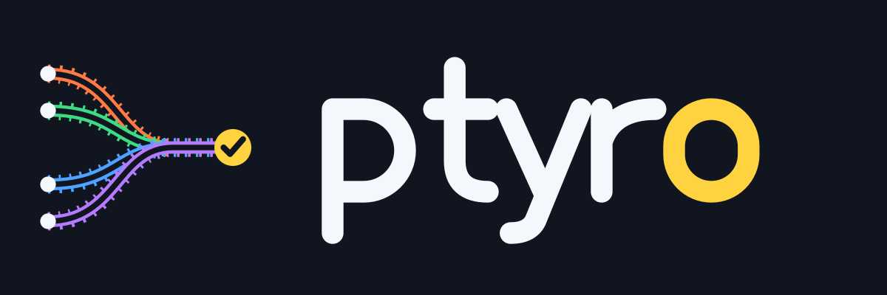 

`33-junction-logo.svg` · `33-junction-logo.png` · `33-junction-icon.svg` · `33-junction-icon.png`

## 34. Signal

The merge queue's signal: only the green light is on.

 

`34-signal-logo.svg` · `34-signal-logo.png` · `34-signal-icon.svg` · `34-signal-icon.png`

## 35. Departures

The departures board: every change, its status, and when it leaves.

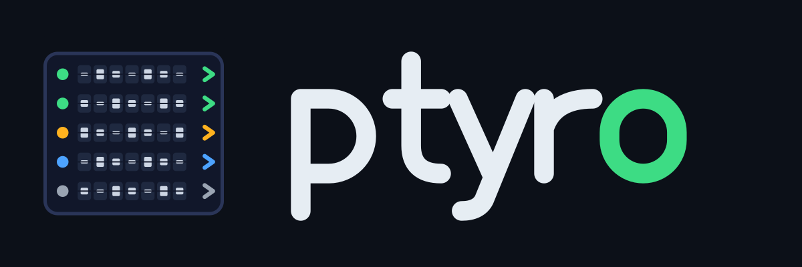 

`35-departures-logo.svg` · `35-departures-logo.png` · `35-departures-icon.svg` · `35-departures-icon.png`

## 36. Caboose

Last car on the train, with a prompt in its window.

 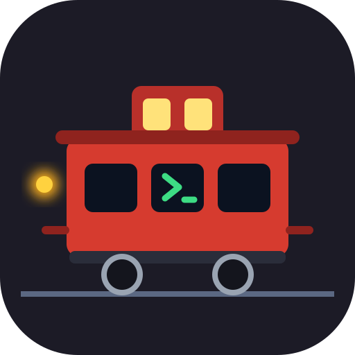

`36-caboose-logo.svg` · `36-caboose-logo.png` · `36-caboose-icon.svg` · `36-caboose-icon.png`

## 37. Ticket

A ticket to main, punched and perforated, one stripe per agent.

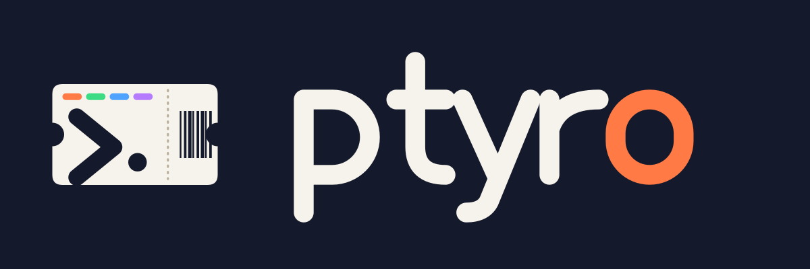 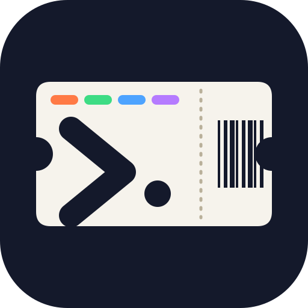

`37-ticket-logo.svg` · `37-ticket-logo.png` · `37-ticket-icon.svg` · `37-ticket-icon.png`

## 38. Tunnel

Through the tunnel: colour rings, rails and a headlight.

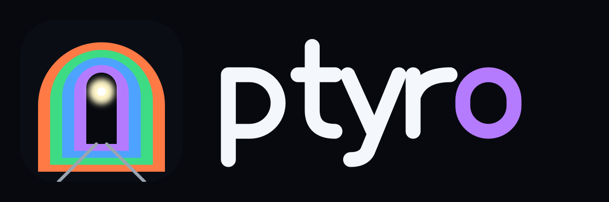 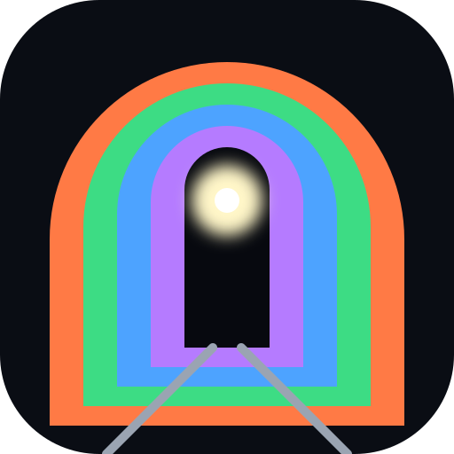

`38-tunnel-logo.svg` · `38-tunnel-logo.png` · `38-tunnel-icon.svg` · `38-tunnel-icon.png`

## 39. Turntable

The roundhouse: six tracks, one train lined up to leave.

 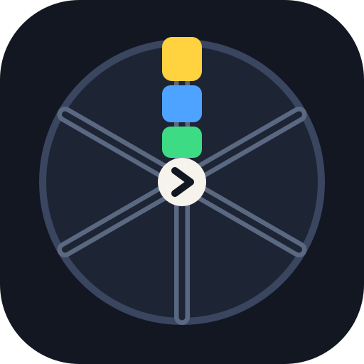

`39-turntable-logo.svg` · `39-turntable-logo.png` · `39-turntable-icon.svg` · `39-turntable-icon.png`

## 40. Pixel Train

The merge train in terminal cells, chevron on every car.

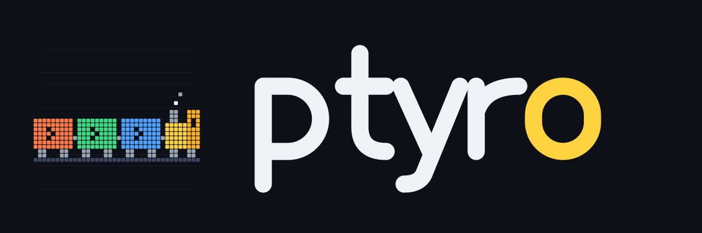 

`40-pixel-train-logo.svg` · `40-pixel-train-logo.png` · `40-pixel-train-icon.svg` · `40-pixel-train-icon.png`

## 41. Ptero in Flight

A pterodactyl gliding past the clouds, wing raised.

 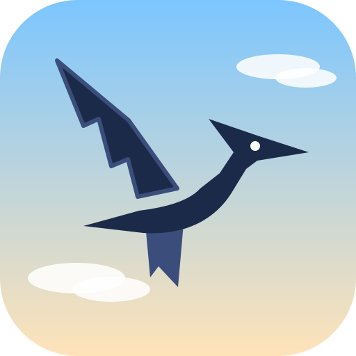

`41-ptero-flight-logo.svg` · `41-ptero-flight-logo.png` · `41-ptero-flight-icon.svg` · `41-ptero-flight-icon.png`

## 42. 8-Bit Ptero

A pixel pterodactyl, a nod to the one in the offline-dinosaur game.

 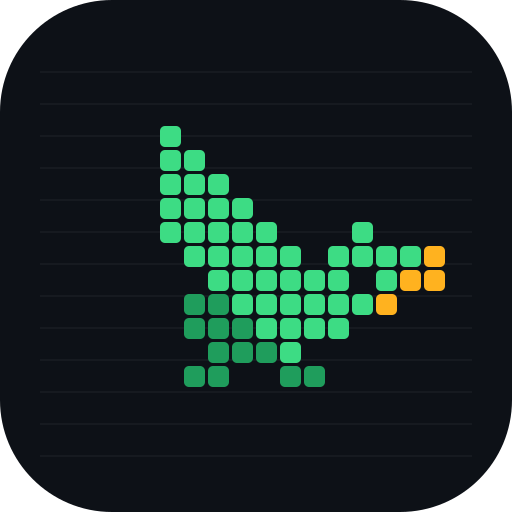

`42-ptero-pixel-logo.svg` · `42-ptero-pixel-logo.png` · `42-ptero-pixel-icon.svg` · `42-ptero-pixel-icon.png`

## 43. Hatchling

A new session hatches: a baby pterodactyl cracking out of its egg.

 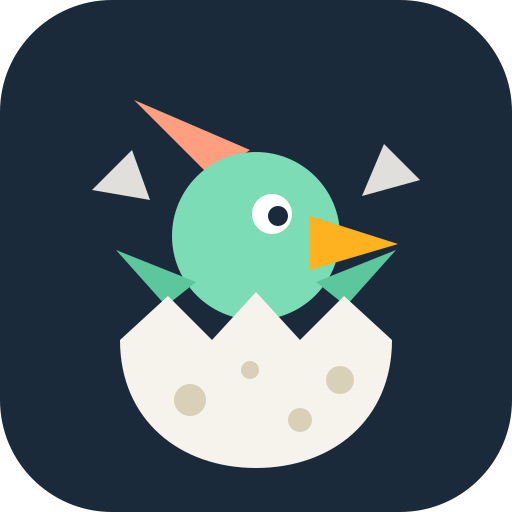

`43-hatchling-logo.svg` · `43-hatchling-logo.png` · `43-hatchling-icon.svg` · `43-hatchling-icon.png`

## 44. Fossil

The wing bones in stone: old, but still resumable.

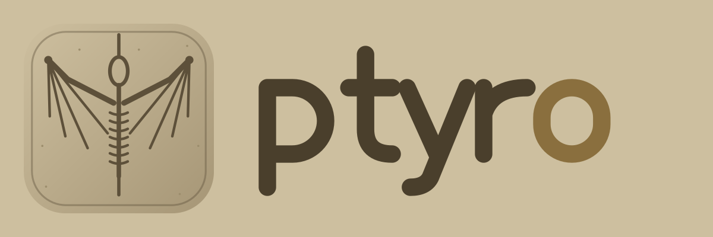 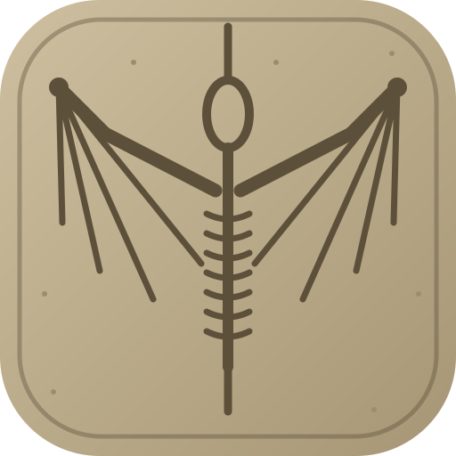

`44-fossil-logo.svg` · `44-fossil-logo.png` · `44-fossil-icon.svg` · `44-fossil-icon.png`

## 45. Low Poly

Faceted, in teal and violet.

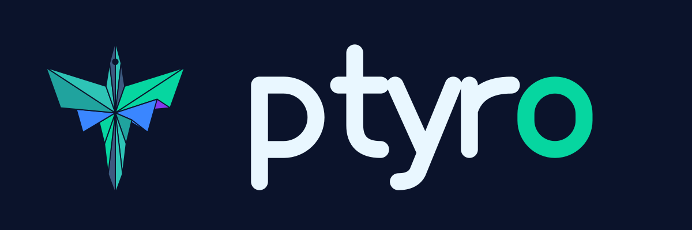 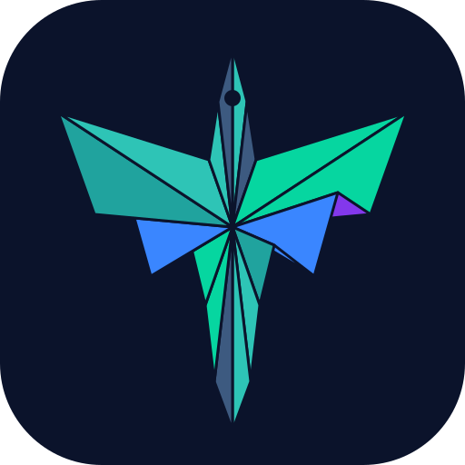

`45-low-poly-logo.svg` · `45-low-poly-logo.png` · `45-low-poly-icon.svg` · `45-low-poly-icon.png`

## 46. Baby Ptero

The friendly mascot: big eyes, tiny wings, rosy cheeks.

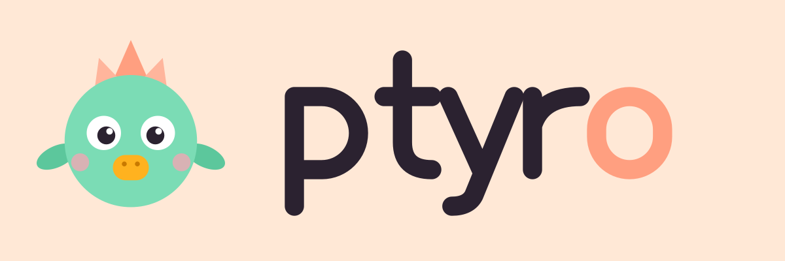 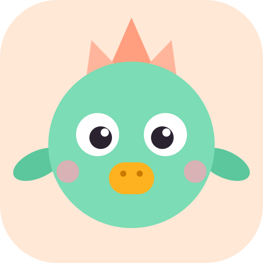

`46-baby-ptero-logo.svg` · `46-baby-ptero-logo.png` · `46-baby-ptero-icon.svg` · `46-baby-ptero-icon.png`

## 47. Chevron Wings

Wings made of `<` and `>`: the terminal takes flight.

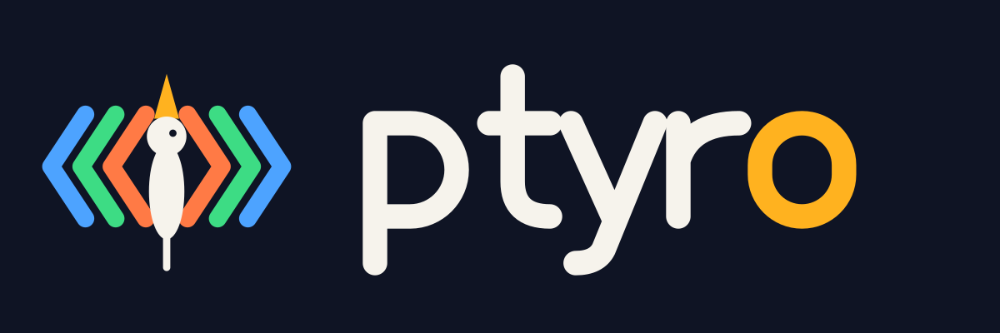 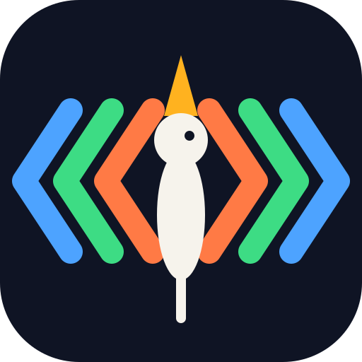

`47-chevron-wings-logo.svg` · `47-chevron-wings-logo.png` · `47-chevron-wings-icon.svg` · `47-chevron-wings-icon.png`

## 48. Sunset

A pterodactyl across a retro sunset, mountains below.

 

`48-sunset-ptero-logo.svg` · `48-sunset-ptero-logo.png` · `48-sunset-ptero-icon.svg` · `48-sunset-ptero-icon.png`

## 49. Circuit

Circuit-board wings: part reptile, part machine.

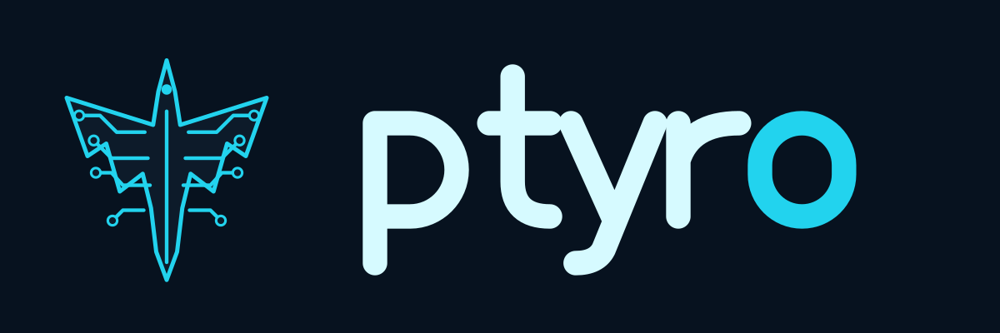 

`49-circuit-ptero-logo.svg` · `49-circuit-ptero-logo.png` · `49-circuit-ptero-icon.svg` · `49-circuit-ptero-icon.png`

## 50. The Pack

Five pterodactyls in formation: a lead and four followers.

 

`50-pack-logo.svg` · `50-pack-logo.png` · `50-pack-icon.svg` · `50-pack-icon.png`

