# ptyro logos

120 concepts, each as a wide **logo** (1200×400) and a square **icon** (512×512), in SVG and PNG. Every image file is in [`ideas/`](ideas/). Concepts 01–50 explore themes; 51–120 are ten riffs on each of seven favourites (05, 22, 23, 25, 28, 48, 45), built from few shapes, thick strokes and strong contrast so they read from a distance. Generated by `scripts/logos.py`; run `make logos` to rebuild (PNGs need `rsvg-convert`). The wordmark is drawn, not typeset, so no fonts are needed.

# The chosen logo

From concept 91 (Bento Three). Use the dark set on dark or colourful pages and the `-on-white` set on white or light ones (its logo has a solid white background).

 

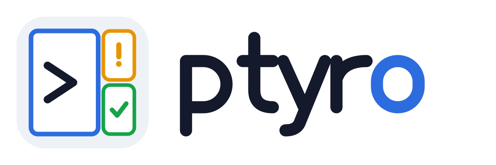 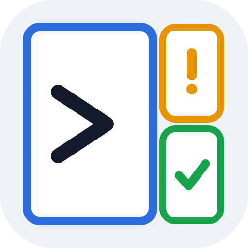

`ptyro-logo` · `ptyro-icon` · `ptyro-logo-on-white` · `ptyro-icon-on-white`, each as `.svg` and `.png`

# The flame

## 01. Prompt Flame

A flame with a `>_` prompt cut out of it: the terminal, on fire.

 

`01-prompt-flame-logo.svg` · `01-prompt-flame-logo.png` · `01-prompt-flame-icon.svg` · `01-prompt-flame-icon.png`

## 02. Pixel Flame

The flame, drawn in terminal cells.

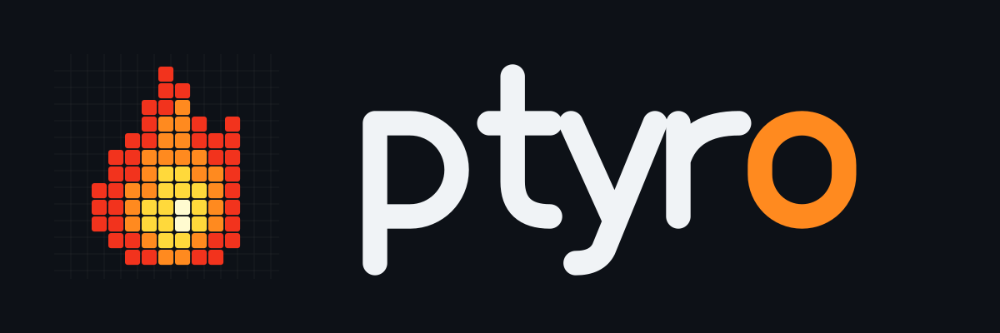 

`02-pixel-flame-logo.svg` · `02-pixel-flame-logo.png` · `02-pixel-flame-icon.svg` · `02-pixel-flame-icon.png`

## 03. Fork Y

The `y` is a git fork: one trunk, three worktrees, one of them burning.

 

`03-fork-y-logo.svg` · `03-fork-y-logo.png` · `03-fork-y-icon.svg` · `03-fork-y-icon.png`

## 04. Strike a Match

Every agent starts with a spark. The match head is a block cursor.

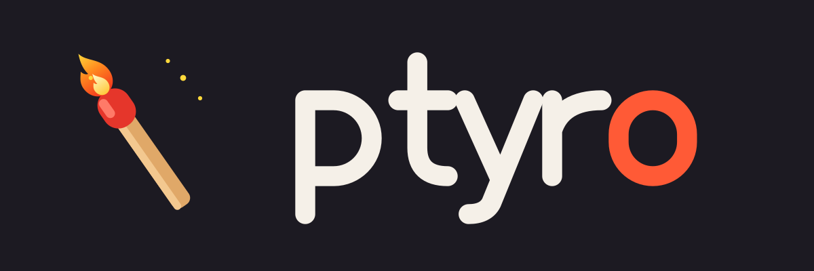 

`04-match-logo.svg` · `04-match-logo.png` · `04-match-icon.svg` · `04-match-icon.png`

## 05. Fireworks

Pyrotechnics: a burst of agents (four colours, one prompt in the middle).

 

`05-fireworks-logo.svg` · `05-fireworks-logo.png` · `05-fireworks-icon.svg` · `05-fireworks-icon.png`

## 06. Four Panes

Four sessions side by side, each with its status colour.

 

`06-four-panes-logo.svg` · `06-four-panes-logo.png` · `06-four-panes-icon.svg` · `06-four-panes-icon.png`

## 07. Phosphor

A green-phosphor CRT, because it is a terminal after all.

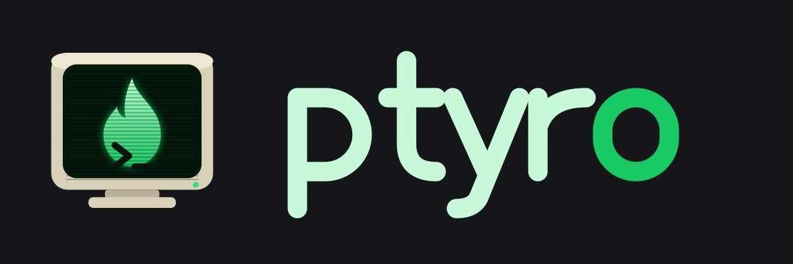 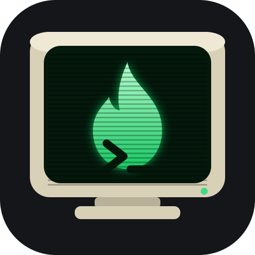

`07-crt-logo.svg` · `07-crt-logo.png` · `07-crt-icon.svg` · `07-crt-icon.png`

## 08. The Daemon

A little pixel imp: the background daemon that keeps your agents alive.

 

`08-daemon-logo.svg` · `08-daemon-logo.png` · `08-daemon-icon.svg` · `08-daemon-icon.png`

## 09. Campfire

Agents gather round the fire; you can leave and it keeps burning.

 

`09-campfire-logo.svg` · `09-campfire-logo.png` · `09-campfire-icon.svg` · `09-campfire-icon.png`

## 10. Status Ring

Working, blocked, idle, done: the four states around one flame.

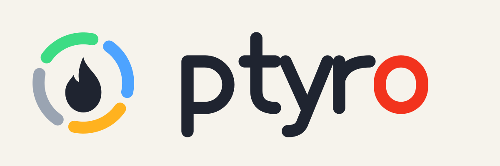 

`10-status-ring-logo.svg` · `10-status-ring-logo.png` · `10-status-ring-icon.svg` · `10-status-ring-icon.png`

# No fire

## 11. Pty Pair

A pty is two ends of one pipe: the master and the slave, a prompt and its cursor.

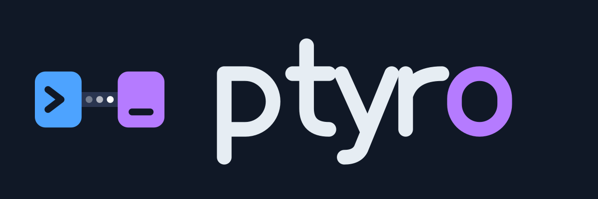 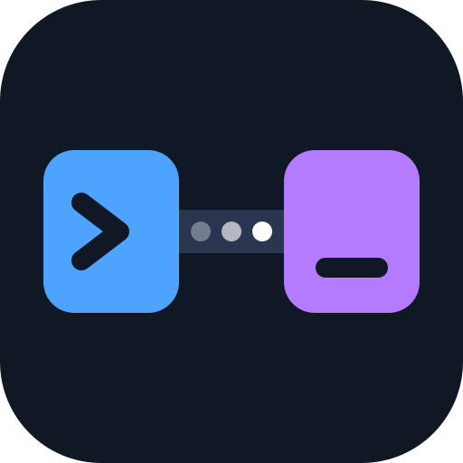

`11-pty-pair-logo.svg` · `11-pty-pair-logo.png` · `11-pty-pair-icon.svg` · `11-pty-pair-icon.png`

## 12. Ptero

p-t-y-ro, say it fast: a pterodactyl, wings spread over your terminal.

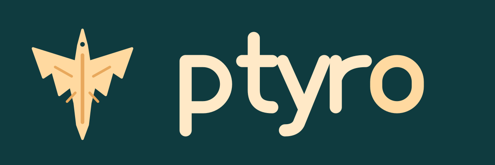 

`12-pterodactyl-logo.svg` · `12-pterodactyl-logo.png` · `12-pterodactyl-icon.svg` · `12-pterodactyl-icon.png`

## 13. Octopus

Eight arms, eight sessions, one cheerful head keeping track of all of them.

 

`13-octopus-logo.svg` · `13-octopus-logo.png` · `13-octopus-icon.svg` · `13-octopus-icon.png`

## 14. Lighthouse

One beam sweeping the dark to show which agent needs you.

 

`14-lighthouse-logo.svg` · `14-lighthouse-logo.png` · `14-lighthouse-icon.svg` · `14-lighthouse-icon.png`

## 15. Constellation

Sessions as stars, joined into a p.

 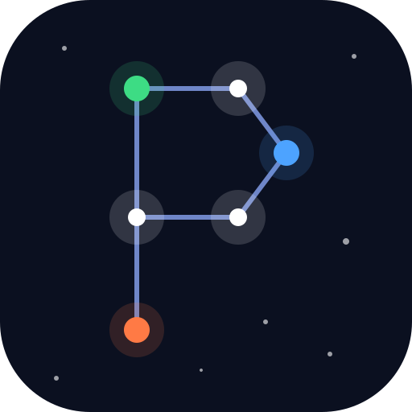

`15-constellation-logo.svg` · `15-constellation-logo.png` · `15-constellation-icon.svg` · `15-constellation-icon.png`

## 16. Honeycomb

A hive of workers: one cell per agent, one key to the cell that is buzzing.

 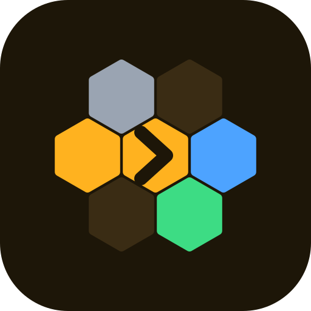

`16-honeycomb-logo.svg` · `16-honeycomb-logo.png` · `16-honeycomb-icon.svg` · `16-honeycomb-icon.png`

## 17. Friendly Robot

A robot whose face is a prompt and a smile: `> <`.

 

`17-robot-logo.svg` · `17-robot-logo.png` · `17-robot-icon.svg` · `17-robot-icon.png`

## 18. Radar

A sweep, four blips, one of them amber: an agent is blocked on you.

 

`18-radar-logo.svg` · `18-radar-logo.png` · `18-radar-icon.svg` · `18-radar-icon.png`

## 19. Orbit

Four agents in orbit around one planet of code.

 

`19-orbit-logo.svg` · `19-orbit-logo.png` · `19-orbit-icon.svg` · `19-orbit-icon.png`

## 20. Turtle

Slow and steady, and it never loses its home: the shell is a terminal.

 

`20-turtle-logo.svg` · `20-turtle-logo.png` · `20-turtle-icon.svg` · `20-turtle-icon.png`

# Many agents at once

## 21. Flock

A flock in formation: one lead, six following, all heading the same way.

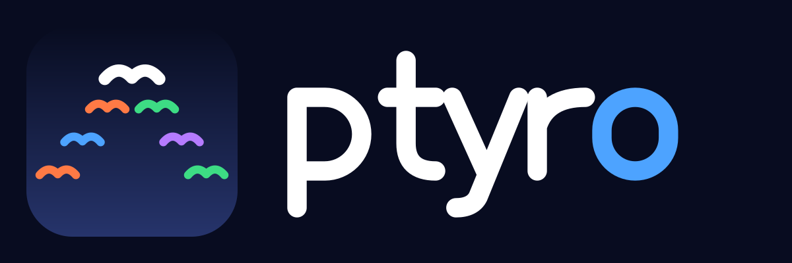 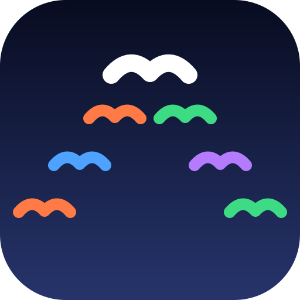

`21-flock-logo.svg` · `21-flock-logo.png` · `21-flock-icon.svg` · `21-flock-icon.png`

## 22. Hub and Spoke

A lead agent in the middle, workers around it: orchestration in one picture.

 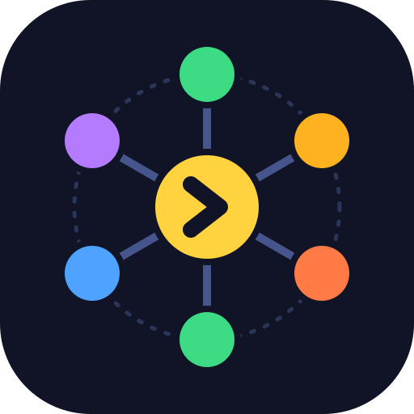

`22-hub-logo.svg` · `22-hub-logo.png` · `22-hub-icon.svg` · `22-hub-icon.png`

## 23. Chain

Four chevrons, four agents: the output of one is the prompt of the next (recipes).

 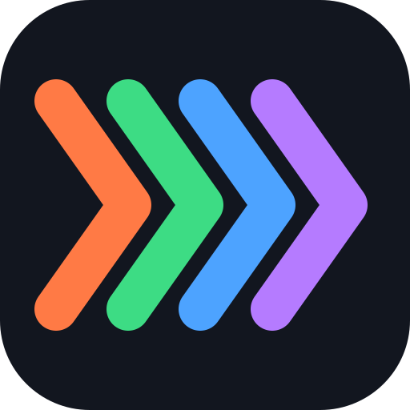

`23-chain-logo.svg` · `23-chain-logo.png` · `23-chain-icon.svg` · `23-chain-icon.png`

## 24. Fan Out

One task fans out to many agents, you pick the best, and it comes back as one.

 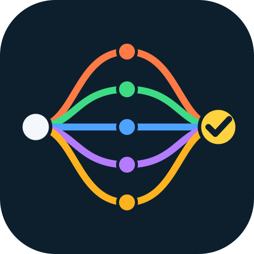

`24-fan-logo.svg` · `24-fan-logo.png` · `24-fan-icon.svg` · `24-fan-icon.png`

## 25. Squad

A pixel crew of four, one colour each.

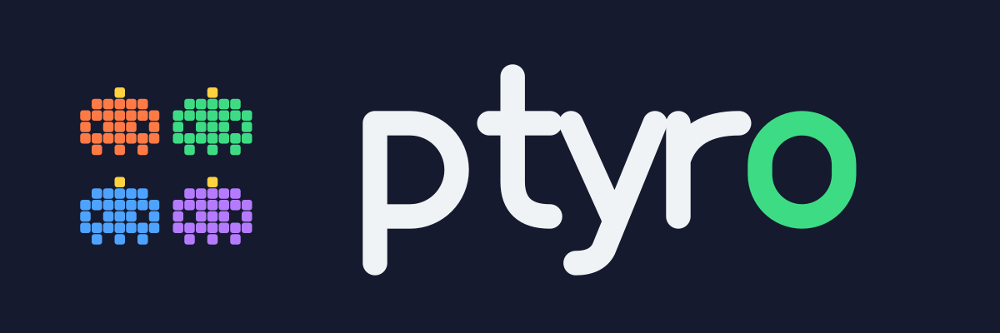 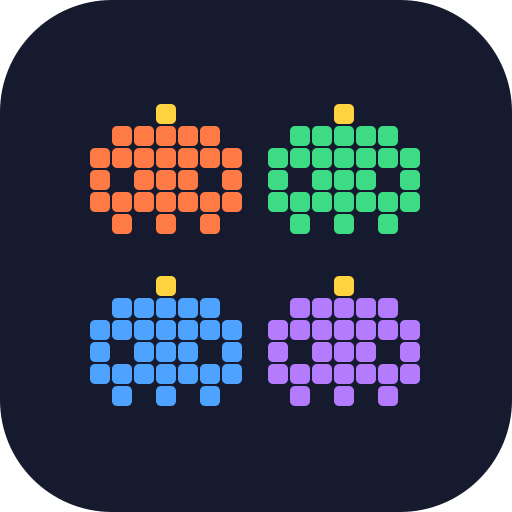

`25-squad-logo.svg` · `25-squad-logo.png` · `25-squad-icon.svg` · `25-squad-icon.png`

## 26. Merge Train

Each agent's change is a car; the train rolls into main in order.

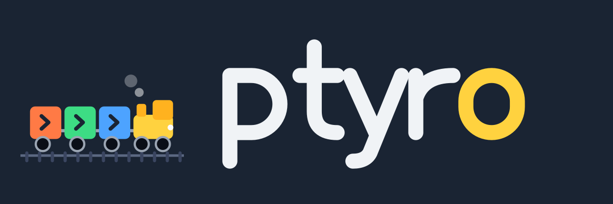 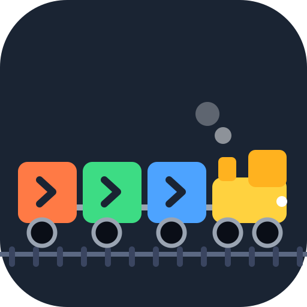

`26-merge-train-logo.svg` · `26-merge-train-logo.png` · `26-merge-train-icon.svg` · `26-merge-train-icon.png`

## 27. Overlap

Many agents, one shared prompt in the middle.

 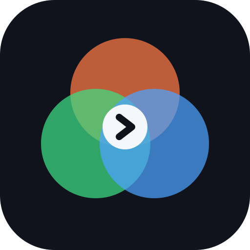

`27-venn-logo.svg` · `27-venn-logo.png` · `27-venn-icon.svg` · `27-venn-icon.png`

## 28. Bento

A tiled workspace: the big pane you work in, the small ones that report status.

 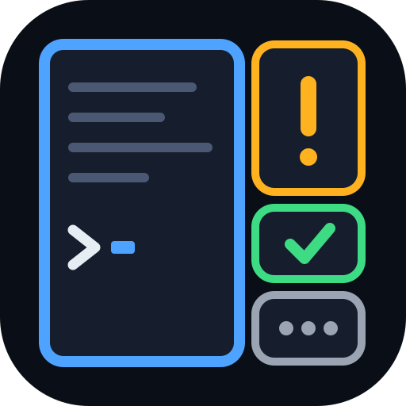

`28-bento-logo.svg` · `28-bento-logo.png` · `28-bento-icon.svg` · `28-bento-icon.png`

## 29. Ducks in a Row

Get your ducks in a row: a lead duck and four followers.

 

`29-ducks-logo.svg` · `29-ducks-logo.png` · `29-ducks-icon.svg` · `29-ducks-icon.png`

## 30. Marionette

One hand, four strings: you steer all the agents at once.

 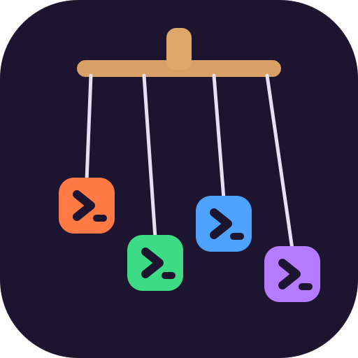

`30-marionette-logo.svg` · `30-marionette-logo.png` · `30-marionette-icon.svg` · `30-marionette-icon.png`

# The merge train

## 31. Locomotive

The engine head-on, with a prompt on its smokebox door.

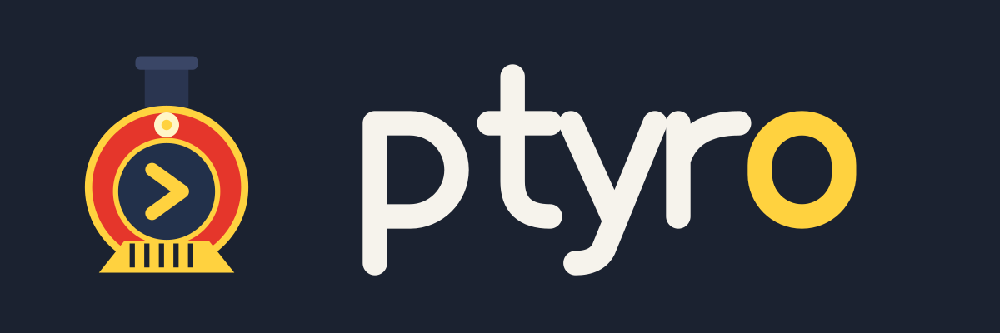 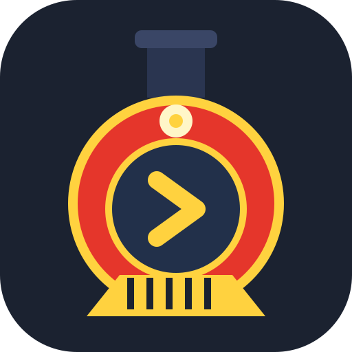

`31-locomotive-logo.svg` · `31-locomotive-logo.png` · `31-locomotive-icon.svg` · `31-locomotive-icon.png`

## 32. Bullet Train

Fast and streamlined: four agents at the windows, no stops.

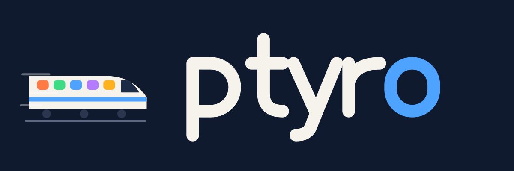 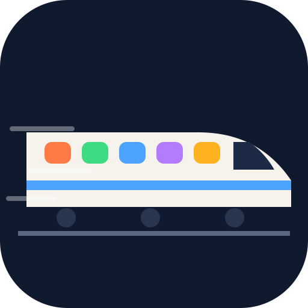

`32-bullet-train-logo.svg` · `32-bullet-train-logo.png` · `32-bullet-train-icon.svg` · `32-bullet-train-icon.png`

## 33. Junction

Four tracks merge into one, ending in a green check: a merge, drawn as rail.

 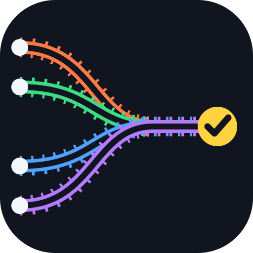

`33-junction-logo.svg` · `33-junction-logo.png` · `33-junction-icon.svg` · `33-junction-icon.png`

## 34. Signal

The merge queue's signal: only the green light is on.

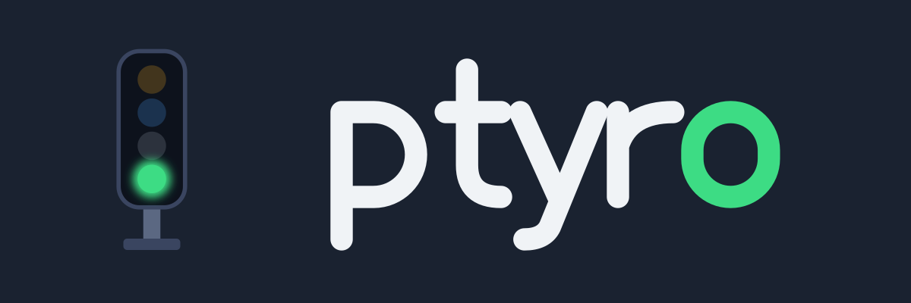 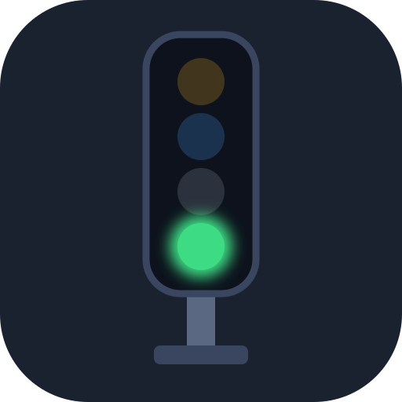

`34-signal-logo.svg` · `34-signal-logo.png` · `34-signal-icon.svg` · `34-signal-icon.png`

## 35. Departures

The departures board: every change, its status, and when it leaves.

 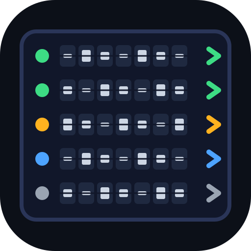

`35-departures-logo.svg` · `35-departures-logo.png` · `35-departures-icon.svg` · `35-departures-icon.png`

## 36. Caboose

Last car on the train, with a prompt in its window.

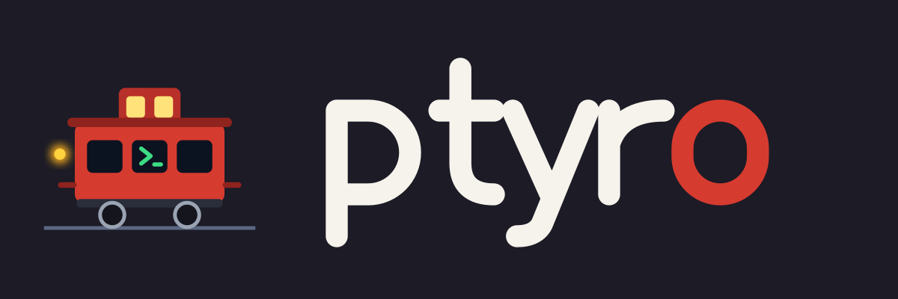 

`36-caboose-logo.svg` · `36-caboose-logo.png` · `36-caboose-icon.svg` · `36-caboose-icon.png`

## 37. Ticket

A ticket to main, punched and perforated, one stripe per agent.

 

`37-ticket-logo.svg` · `37-ticket-logo.png` · `37-ticket-icon.svg` · `37-ticket-icon.png`

## 38. Tunnel

Through the tunnel: colour rings, rails and a headlight.

 

`38-tunnel-logo.svg` · `38-tunnel-logo.png` · `38-tunnel-icon.svg` · `38-tunnel-icon.png`

## 39. Turntable

The roundhouse: six tracks, one train lined up to leave.

 

`39-turntable-logo.svg` · `39-turntable-logo.png` · `39-turntable-icon.svg` · `39-turntable-icon.png`

## 40. Pixel Train

The merge train in terminal cells, chevron on every car.

 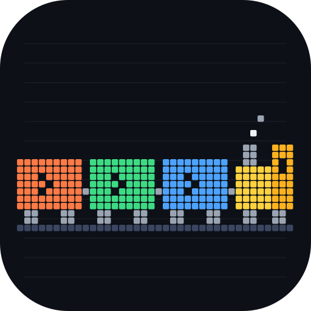

`40-pixel-train-logo.svg` · `40-pixel-train-logo.png` · `40-pixel-train-icon.svg` · `40-pixel-train-icon.png`

# Pterodactyls

## 41. Ptero in Flight

A pterodactyl gliding past the clouds, wing raised.

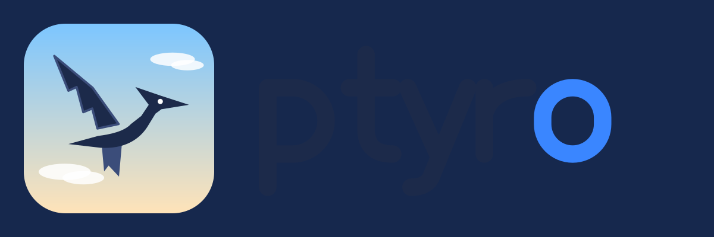 

`41-ptero-flight-logo.svg` · `41-ptero-flight-logo.png` · `41-ptero-flight-icon.svg` · `41-ptero-flight-icon.png`

## 42. 8-Bit Ptero

A pixel pterodactyl, a nod to the one in the offline-dinosaur game.

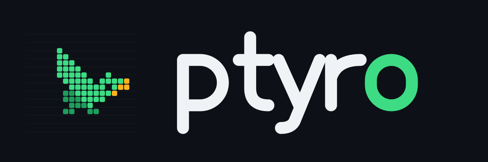 

`42-ptero-pixel-logo.svg` · `42-ptero-pixel-logo.png` · `42-ptero-pixel-icon.svg` · `42-ptero-pixel-icon.png`

## 43. Hatchling

A new session hatches: a baby pterodactyl cracking out of its egg.

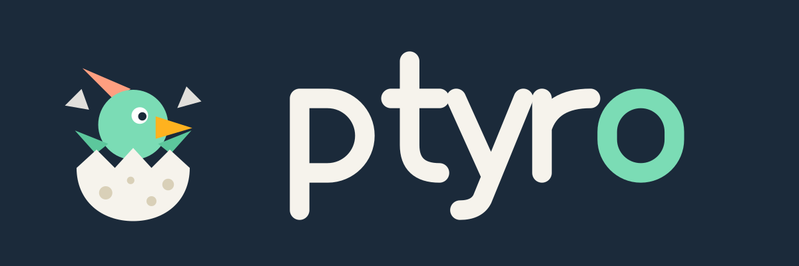 

`43-hatchling-logo.svg` · `43-hatchling-logo.png` · `43-hatchling-icon.svg` · `43-hatchling-icon.png`

## 44. Fossil

The wing bones in stone: old, but still resumable.

 

`44-fossil-logo.svg` · `44-fossil-logo.png` · `44-fossil-icon.svg` · `44-fossil-icon.png`

## 45. Low Poly

Faceted, in teal and violet.

 

`45-low-poly-logo.svg` · `45-low-poly-logo.png` · `45-low-poly-icon.svg` · `45-low-poly-icon.png`

## 46. Baby Ptero

The friendly mascot: big eyes, tiny wings, rosy cheeks.

 

`46-baby-ptero-logo.svg` · `46-baby-ptero-logo.png` · `46-baby-ptero-icon.svg` · `46-baby-ptero-icon.png`

## 47. Chevron Wings

Wings made of `<` and `>`: the terminal takes flight.

 

`47-chevron-wings-logo.svg` · `47-chevron-wings-logo.png` · `47-chevron-wings-icon.svg` · `47-chevron-wings-icon.png`

## 48. Sunset

A pterodactyl across a retro sunset, mountains below.

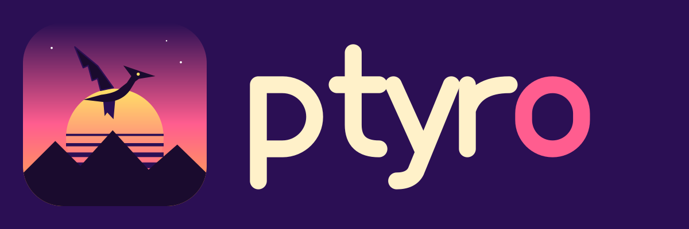 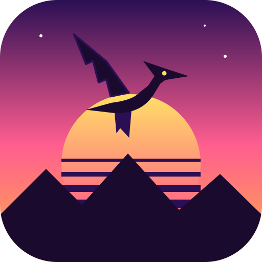

`48-sunset-ptero-logo.svg` · `48-sunset-ptero-logo.png` · `48-sunset-ptero-icon.svg` · `48-sunset-ptero-icon.png`

## 49. Circuit

Circuit-board wings: part reptile, part machine.

 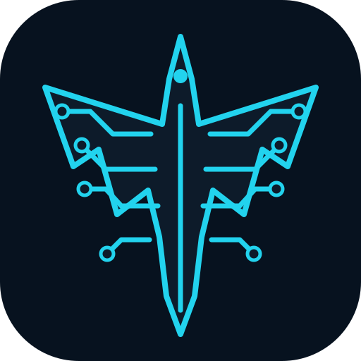

`49-circuit-ptero-logo.svg` · `49-circuit-ptero-logo.png` · `49-circuit-ptero-icon.svg` · `49-circuit-ptero-icon.png`

## 50. The Pack

Five pterodactyls in formation: a lead and four followers.

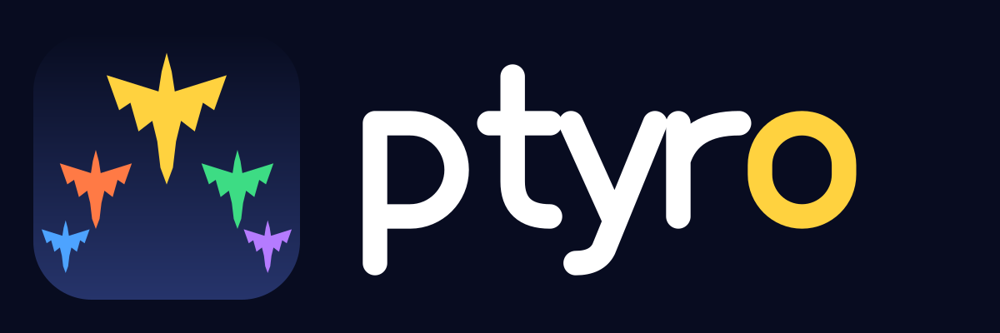 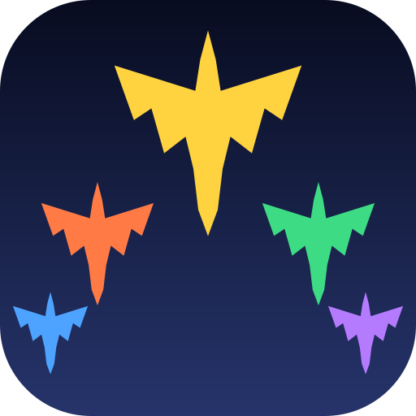

`50-pack-logo.svg` · `50-pack-logo.png` · `50-pack-icon.svg` · `50-pack-icon.png`

# Riffs on 05 Fireworks

## 51. Fireworks: Mono

One colour of ray, one gold chevron: the burst at its simplest.

 

`51-fw-mono-logo.svg` · `51-fw-mono-logo.png` · `51-fw-mono-icon.svg` · `51-fw-mono-icon.png`

## 52. Fireworks: Starburst

Sixteen rays, long and short, in agent colours around a gold core.

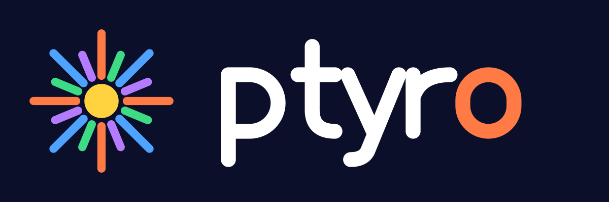 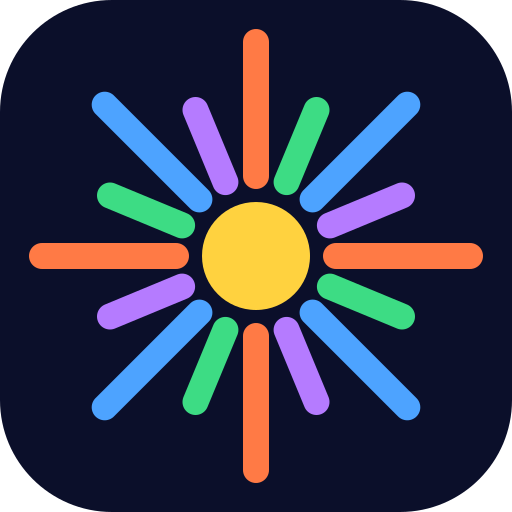

`52-fw-starburst-logo.svg` · `52-fw-starburst-logo.png` · `52-fw-starburst-icon.svg` · `52-fw-starburst-icon.png`

## 53. Fireworks: Pinwheel

The rays curl: a spinning wheel of four colours.

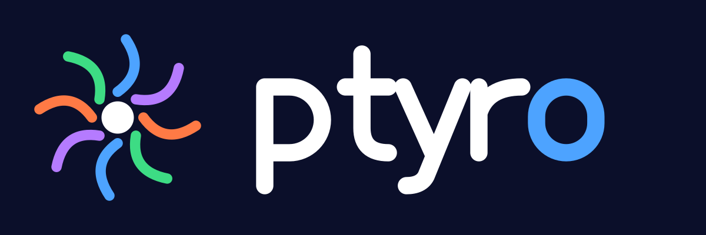 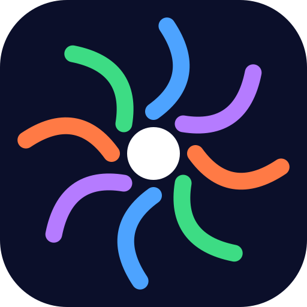

`53-fw-pinwheel-logo.svg` · `53-fw-pinwheel-logo.png` · `53-fw-pinwheel-icon.svg` · `53-fw-pinwheel-icon.png`

## 54. Fireworks: Asterisk

Four fat strokes crossing: the shape reads at any size.

 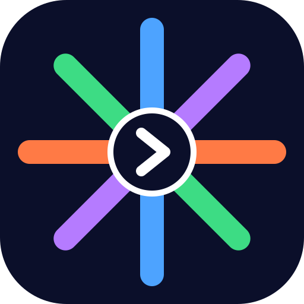

`54-fw-asterisk-logo.svg` · `54-fw-asterisk-logo.png` · `54-fw-asterisk-icon.svg` · `54-fw-asterisk-icon.png`

## 55. Fireworks: Launch

A chevron fires; the burst fans out from its tip.

 

`55-fw-launch-logo.svg` · `55-fw-launch-logo.png` · `55-fw-launch-icon.svg` · `55-fw-launch-icon.png`

## 56. Fireworks: Trio

Three bursts at three sizes, trails rising behind.

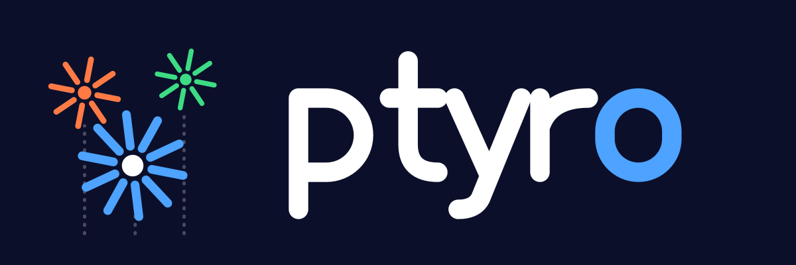 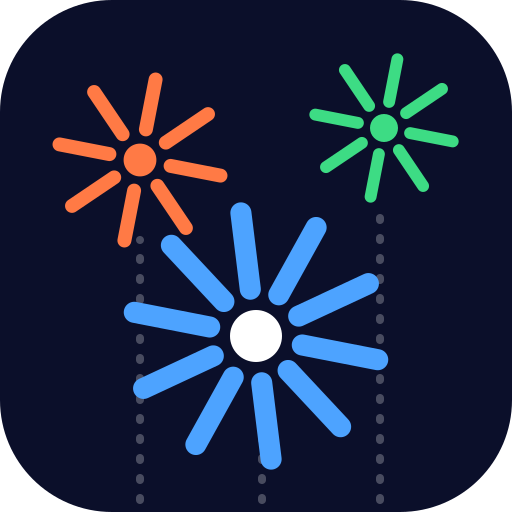

`56-fw-trio-logo.svg` · `56-fw-trio-logo.png` · `56-fw-trio-icon.svg` · `56-fw-trio-icon.png`

## 57. Fireworks: Sparkle

A single gold sparkle with four coloured satellites.

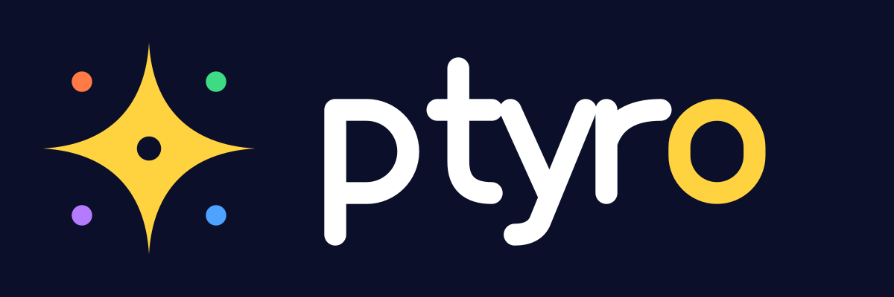 

`57-fw-sparkle-logo.svg` · `57-fw-sparkle-logo.png` · `57-fw-sparkle-icon.svg` · `57-fw-sparkle-icon.png`

## 58. Fireworks: Shockwave

Three dashed rings expanding from a white core.

 

`58-fw-shock-logo.svg` · `58-fw-shock-logo.png` · `58-fw-shock-icon.svg` · `58-fw-shock-icon.png`

## 59. Fireworks: Confetti

Rounded confetti flying outward, a chevron in the middle.

 

`59-fw-confetti-logo.svg` · `59-fw-confetti-logo.png` · `59-fw-confetti-icon.svg` · `59-fw-confetti-icon.png`

## 60. Fireworks: Daylight

The burst on a light page, inked in navy.

 

`60-fw-light-logo.svg` · `60-fw-light-logo.png` · `60-fw-light-icon.svg` · `60-fw-light-icon.png`

# Riffs on 22 Hub

## 61. Hub: Four Corners

Four fat workers on the diagonals; the lead is a big gold disc.

 

`61-hub-four-logo.svg` · `61-hub-four-logo.png` · `61-hub-four-icon.svg` · `61-hub-four-icon.png`

## 62. Hub: Crown

The lead wears a crown; five workers fan below.

 

`62-hub-crown-logo.svg` · `62-hub-crown-logo.png` · `62-hub-crown-icon.svg` · `62-hub-crown-icon.png`

## 63. Hub: Triangle

Three workers and a lead: the minimum that still says orchestra.

 

`63-hub-tri-logo.svg` · `63-hub-tri-logo.png` · `63-hub-tri-icon.svg` · `63-hub-tri-icon.png`

## 64. Hub: Hex

A hexagon lead with six hexagon workers.

 

`64-hub-hex-logo.svg` · `64-hub-hex-logo.png` · `64-hub-hex-icon.svg` · `64-hub-hex-icon.png`

## 65. Hub: Helm

A ship's wheel: the lead at the hub, an agent on each handle.

 

`65-hub-helm-logo.svg` · `65-hub-helm-logo.png` · `65-hub-helm-icon.svg` · `65-hub-helm-icon.png`

## 66. Hub: Bracket

A big lead at left, four workers hanging off a bracket.

 

`66-hub-bracket-logo.svg` · `66-hub-bracket-logo.png` · `66-hub-bracket-icon.svg` · `66-hub-bracket-icon.png`

## 67. Hub: Star

Eight nodes at two distances: a starfish of agents.

 

`67-hub-star-logo.svg` · `67-hub-star-logo.png` · `67-hub-star-icon.svg` · `67-hub-star-icon.png`

## 68. Hub: Cross

A square lead, four corner workers, joined in an X.

 

`68-hub-corners-logo.svg` · `68-hub-corners-logo.png` · `68-hub-corners-icon.svg` · `68-hub-corners-icon.png`

## 69. Hub: Org Chart

The lead on top, three workers underneath.

 

`69-hub-tree-logo.svg` · `69-hub-tree-logo.png` · `69-hub-tree-icon.svg` · `69-hub-tree-icon.png`

## 70. Hub: Ring

A white ring lead; workers of every size around it.

 

`70-hub-ring-logo.svg` · `70-hub-ring-logo.png` · `70-hub-ring-icon.svg` · `70-hub-ring-icon.png`

# Riffs on 23 Chain

## 71. Chain: Three

Three huge chevrons: it fits a favicon.

 

`71-chain-3-logo.svg` · `71-chain-3-logo.png` · `71-chain-3-icon.svg` · `71-chain-3-icon.png`

## 72. Chain: Five

Five slim chevrons, a rainbow in sequence.

 

`72-chain-5-logo.svg` · `72-chain-5-logo.png` · `72-chain-5-icon.svg` · `72-chain-5-icon.png`

## 73. Chain: Cycle

Four chevrons chasing each other round a circle.

 

`73-chain-ring-logo.svg` · `73-chain-ring-logo.png` · `73-chain-ring-icon.svg` · `73-chain-ring-icon.png`

## 74. Chain: Cursor

Three chevrons, then a block cursor: the next prompt waiting.

 

`74-chain-cursor-logo.svg` · `74-chain-cursor-logo.png` · `74-chain-cursor-icon.svg` · `74-chain-cursor-icon.png`

## 75. Chain: Nested

One chevron inside another, four deep, like a tunnel.

 

`75-chain-nested-logo.svg` · `75-chain-nested-logo.png` · `75-chain-nested-icon.svg` · `75-chain-nested-icon.png`

## 76. Chain: Flag

A single chevron cut from four colour bands.

 

`76-chain-flag-logo.svg` · `76-chain-flag-logo.png` · `76-chain-flag-icon.svg` · `76-chain-flag-icon.png`

## 77. Chain: Fast Forward

Solid triangles, like a fast-forward button.

 

`77-chain-ff-logo.svg` · `77-chain-ff-logo.png` · `77-chain-ff-icon.svg` · `77-chain-ff-icon.png`

## 78. Chain: Queue

Three dots waiting in line, one chevron going.

 

`78-chain-queue-logo.svg` · `78-chain-queue-logo.png` · `78-chain-queue-icon.svg` · `78-chain-queue-icon.png`

## 79. Chain: Pill

Four chevrons on a conveyor track.

 

`79-chain-pill-logo.svg` · `79-chain-pill-logo.png` · `79-chain-pill-icon.svg` · `79-chain-pill-icon.png`

## 80. Chain: Staircase

Chevrons climbing: every step hands off to the next.

 

`80-chain-stair-logo.svg` · `80-chain-stair-logo.png` · `80-chain-stair-icon.svg` · `80-chain-stair-icon.png`

# Riffs on 25 Squad

## 81. Squad: One Big Invader

One crab, huge, in orange: it reads from across the room.

 

`81-squad-one-logo.svg` · `81-squad-one-logo.png` · `81-squad-one-icon.svg` · `81-squad-one-icon.png`

## 82. Squad: Three Types

A squid, a crab and an octopus stacked.

 

`82-squad-types-logo.svg` · `82-squad-types-logo.png` · `82-squad-types-icon.svg` · `82-squad-types-icon.png`

## 83. Squad: Formation

Nine invaders in rows; the gold one is the lead.

 

`83-squad-grid-logo.svg` · `83-squad-grid-logo.png` · `83-squad-grid-icon.svg` · `83-squad-grid-icon.png`

## 84. Squad: Screen Belly

An invader with a terminal for a belly.

 

`84-squad-screen-logo.svg` · `84-squad-screen-logo.png` · `84-squad-screen-icon.svg` · `84-squad-screen-icon.png`

## 85. Squad: Big Bot

The little robot, enlarged to fill the tile.

 

`85-squad-bot-logo.svg` · `85-squad-bot-logo.png` · `85-squad-bot-icon.svg` · `85-squad-bot-icon.png`

## 86. Squad: Laser

A cannon fires up at the lead invader.

 

`86-squad-laser-logo.svg` · `86-squad-laser-logo.png` · `86-squad-laser-icon.svg` · `86-squad-laser-icon.png`

## 87. Squad: V Formation

Five squids in a V, the lead in gold.

 

`87-squad-v-logo.svg` · `87-squad-v-logo.png` · `87-squad-v-icon.svg` · `87-squad-v-icon.png`

## 88. Squad: Four Colours

One invader, four colours: the whole squad in one body.

 

`88-squad-quad-logo.svg` · `88-squad-quad-logo.png` · `88-squad-quad-icon.svg` · `88-squad-quad-icon.png`

## 89. Squad: Window

An invader inside a terminal window.

 

`89-squad-window-logo.svg` · `89-squad-window-logo.png` · `89-squad-window-icon.svg` · `89-squad-window-icon.png`

## 90. Squad: Jellies

Four wide-eyed ghosts, one colour each.

 

`90-squad-jelly-logo.svg` · `90-squad-jelly-logo.png` · `90-squad-jelly-icon.svg` · `90-squad-jelly-icon.png`

# Riffs on 28 Bento

## 91. Bento: Three

One big pane and two small: the layout in its plainest form.

 

`91-bento-3-logo.svg` · `91-bento-3-logo.png` · `91-bento-3-icon.svg` · `91-bento-3-icon.png`

## 92. Bento: Strip

A big pane over a strip of four solid status tiles.

 

`92-bento-strip-logo.svg` · `92-bento-strip-logo.png` · `92-bento-strip-icon.svg` · `92-bento-strip-icon.png`

## 93. Bento: Solid

No borders, just colour blocks and one chevron.

 

`93-bento-solid-logo.svg` · `93-bento-solid-logo.png` · `93-bento-solid-icon.svg` · `93-bento-solid-icon.png`

## 94. Bento: Nine

Nine panes, one gold: the one that needs you.

 

`94-bento-3x3-logo.svg` · `94-bento-3x3-logo.png` · `94-bento-3x3-icon.svg` · `94-bento-3x3-icon.png`

## 95. Bento: Flipped

The big pane on the right, a progress ring and bars on the left.

 

`95-bento-flip-logo.svg` · `95-bento-flip-logo.png` · `95-bento-flip-icon.svg` · `95-bento-flip-icon.png`

## 96. Bento: Progress

Four panes, each with a progress bar.

 

`96-bento-bars-logo.svg` · `96-bento-bars-logo.png` · `96-bento-bars-icon.svg` · `96-bento-bars-icon.png`

## 97. Bento: Light

The three-pane bento on cream.

 

`97-bento-light-logo.svg` · `97-bento-light-logo.png` · `97-bento-light-icon.svg` · `97-bento-light-icon.png`

## 98. Bento: Cascade

Three overlapping windows, the front one in focus.

 

`98-bento-cascade-logo.svg` · `98-bento-cascade-logo.png` · `98-bento-cascade-icon.svg` · `98-bento-cascade-icon.png`

## 99. Bento: Tetris

Four tetrominoes tiling a square, one per agent.

 

`99-bento-tetris-logo.svg` · `99-bento-tetris-logo.png` · `99-bento-tetris-icon.svg` · `99-bento-tetris-icon.png`

## 100. Bento: Mondrian

Primary-colour blocks and heavy black lines.

 

`100-bento-mondrian-logo.svg` · `100-bento-mondrian-logo.png` · `100-bento-mondrian-icon.svg` · `100-bento-mondrian-icon.png`

# Riffs on 48 Sunset ptero

## 101. Sunset: Flat

Flat gold sun, one dark pterodactyl: three shapes.

 

`101-sun-flat-logo.svg` · `101-sun-flat-logo.png` · `101-sun-flat-icon.svg` · `101-sun-flat-icon.png`

## 102. Sunset: Stripes

A huge striped sun, the pterodactyl riding high.

 

`102-sun-stripes-logo.svg` · `102-sun-stripes-logo.png` · `102-sun-stripes-icon.svg` · `102-sun-stripes-icon.png`

## 103. Sunset: Head-on

The head-on pterodactyl against the sun.

 

`103-sun-headon-logo.svg` · `103-sun-headon-logo.png` · `103-sun-headon-icon.svg` · `103-sun-headon-icon.png`

## 104. Sunset: Moon

Night flight: the silhouette crosses a full moon.

 

`104-sun-moon-logo.svg` · `104-sun-moon-logo.png` · `104-sun-moon-icon.svg` · `104-sun-moon-icon.png`

## 105. Sunset: Gradient

Just an orange-to-gold sky and one huge silhouette.

 

`105-sun-mono-logo.svg` · `105-sun-mono-logo.png` · `105-sun-mono-icon.svg` · `105-sun-mono-icon.png`

## 106. Sunset: Synthwave

A neon grid floor under a half-sun.

 

`106-sun-grid-logo.svg` · `106-sun-grid-logo.png` · `106-sun-grid-icon.svg` · `106-sun-grid-icon.png`

## 107. Sunset: Dawn

Sun rising with rays over a dark horizon.

 

`107-sun-dawn-logo.svg` · `107-sun-dawn-logo.png` · `107-sun-dawn-icon.svg` · `107-sun-dawn-icon.png`

## 108. Sunset: Cutout

The pterodactyl is a hole in the sun: negative space.

 

`108-sun-cutout-logo.svg` · `108-sun-cutout-logo.png` · `108-sun-cutout-icon.svg` · `108-sun-cutout-icon.png`

## 109. Sunset: Big Bird

A giant silhouette, wing cropped by the edge of the tile.

 

`109-sun-big-logo.svg` · `109-sun-big-logo.png` · `109-sun-big-icon.svg` · `109-sun-big-icon.png`

## 110. Sunset: Duo

Two pterodactyls crossing one sun.

 

`110-sun-duo-logo.svg` · `110-sun-duo-logo.png` · `110-sun-duo-icon.svg` · `110-sun-duo-icon.png`

# Riffs on 45 Low poly

## 111. Low Poly: Bold

Fewer, bigger facets in three teals: the long-distance version.

 

`111-poly-bold-logo.svg` · `111-poly-bold-logo.png` · `111-poly-bold-icon.svg` · `111-poly-bold-icon.png`

## 112. Low Poly: Agents

Facets in the four agent colours and amber.

 

`112-poly-rainbow-logo.svg` · `112-poly-rainbow-logo.png` · `112-poly-rainbow-icon.svg` · `112-poly-rainbow-icon.png`

## 113. Low Poly: Warm

Reds, oranges and golds on a deep plum.

 

`113-poly-warm-logo.svg` · `113-poly-warm-logo.png` · `113-poly-warm-icon.svg` · `113-poly-warm-icon.png`

## 114. Low Poly: Light

Blues and violets on cream.

 

`114-poly-light-logo.svg` · `114-poly-light-logo.png` · `114-poly-light-icon.svg` · `114-poly-light-icon.png`

## 115. Low Poly: Close-up

Zoomed in so the wings run off the tile.

 

`115-poly-closeup-logo.svg` · `115-poly-closeup-logo.png` · `115-poly-closeup-icon.svg` · `115-poly-closeup-icon.png`

## 116. Low Poly: Side View

A faceted pterodactyl in profile.

 

`116-poly-side-logo.svg` · `116-poly-side-logo.png` · `116-poly-side-icon.svg` · `116-poly-side-icon.png`

## 117. Low Poly: Badge

The faceted bird inside a round badge.

 

`117-poly-badge-logo.svg` · `117-poly-badge-logo.png` · `117-poly-badge-icon.svg` · `117-poly-badge-icon.png`

## 118. Low Poly: Shaded

Facets shaded from a bright centre to deep teal edges.

 

`118-poly-gradient-logo.svg` · `118-poly-gradient-logo.png` · `118-poly-gradient-icon.svg` · `118-poly-gradient-icon.png`

## 119. Low Poly: Wireframe

Just the edges and vertices, in cyan.

 

`119-poly-wire-logo.svg` · `119-poly-wire-logo.png` · `119-poly-wire-icon.svg` · `119-poly-wire-icon.png`

## 120. Low Poly: Prompt

A prompt chevron cut across the faceted wings.

 

`120-poly-chevron-logo.svg` · `120-poly-chevron-logo.png` · `120-poly-chevron-icon.svg` · `120-poly-chevron-icon.png`

